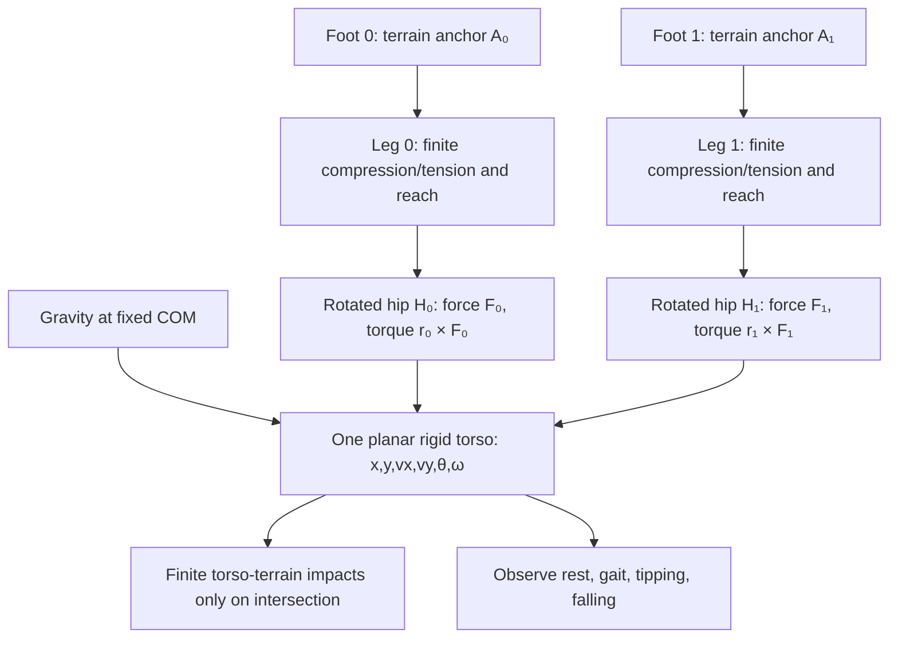

# Entropy — Composable Locomotion
Working plan and progress ledger · 2026-10-16

**Project:** Abyss → Shell → Entropy  
**Status:** Active exploration  
**Canonical runtime:** https://bonoj.github.io/Abyss/shell/  
**Source of truth for this experiment:** this file. Shell recovery/deployment: [HANDOFF.md](./HANDOFF.md).

## Origin: “Should we do composable IK?”

We were considering a reusable fauna assembly layer. The question “Should we do composable IK?” redirected the work toward **composable articulated bodies**, with IK as one capability rather than a species-specific animation system.

Vocabulary: segments, joints and limits; effectors (feet, hands, wings, manipulators); targets (terrain, objects, world positions); independent solvers; contact and gait controllers. Solvers must not know what species or machine they animate. Quadrupeds, hexapods, tentacles, and walking machines remain future demonstrations, not the immediate scope.

## Decision: “We're building a wanderer”

> We're building a wanderer, then. And we explore all different modes of locomotion. Bound by gravity, dragged down but flying, decoupled entirely.

**One Wanderer. Many ways of inhabiting a world.**

Three regimes:
1. **Bound by gravity:** walk, crawl, climb, leap, hang; contacts and support matter.
2. **Fighting gravity:** glide, flap, hover, thrust, buoyancy, controlled descent.
3. **Decoupled:** inertial flight, zero-g manipulation, orbital or authored force fields.

Gravity is an environmental force, not a locomotion mode. Changes between regimes should preserve position, velocity, body identity, and continuity.

Working title: **The Many Ways of Falling**.

## Architecture and ownership

| Authority | Owns |
| --- | --- |
| Navigation | Desired destination, path, and intent |
| Locomotion | Contact scheduling, support, gait, and applied forces |
| Articulation | Joint solutions for the targets and constraints |

Body topology, environmental sensing, and presentation are independently composable. No walking/flying/zero-g subclasses; no solver coupled to species, gravity, terrain, or rendering. Avoid god objects and premature universal physics frameworks. Preserve Genesis and the existing Wanderer until replacement authority is demonstrated.

## Repository inspection / baseline

- Existing `arcana/wanderer.js` is a **floating Hermeticon**, not an articulated walker. It already handles terrain-aware A* paths, clearance, acceleration/braking, tap navigation, and world-offset following. Preserve these.
- `arcana/locomotion/grounding.js` has gravity and contact behavior for ground-supported actors; useful reference, not a universal force engine.
- Entropy composes Arcana under `codex/entropy/world.js`; Genesis is preserved separately.
- A visual follower is **not** yet physically driven locomotion.

## Progress ledger

### A. Reusable two-bone IK — committed
Commit: `ec778c14`  
File: `shell/arcana/locomotion/two-bone-ik.js`

Arbitrary 3D root and target, positive segment lengths, pole-defined bend, reach handling, and error reporting. No Three.js, terrain, gravity, or species dependencies. Numerical edge-case tests and runtime validation still needed.

### B. Articulated Wanderer visual trial — committed, runtime unverified
Commits:
- `33625f01`: add `arcana/locomotion/articulated-trial.js`.
- `affb3d43`: mount the trial in `codex/entropy/world.js` and expose inspection.
- `e1925431`: adjust terrain-relative body position.

A visible body, two IK-driven legs, terrain-sampled foot targets, alternating visual motion, and per-leg error diagnostics. The original Wanderer retains all navigation and movement authority. Contacts are provisional; feet can skate. **No claim of successful Pages deployment or browser execution** based solely on commits.

## Direction correction — gravity first, instrumented autonomous experiments (2026-10-16)

**Observation:** planted feet remained far behind the independently moving body, even after predictive stepping (`e89a2afa`). This is a structural mismatch, not a request for more gait threshold tuning. The reactive gait prototype is preserved as historical code, **not the active experiment**.

**First principle:** locomotion moves a mass through forces while negotiating contacts. Build in this order: external forces → mass/velocity → contact constraints → locomotion control → articulation/IK. Gravity is an input, not a mode.

**Operating agreement:** The assistant authors deterministic, scripted trials; the user need not manually steer. A single JSON report containing chronological samples, events, scenario parameters, diagnostics, and build identity is returned by the user for analysis. Distinguish measured data from estimates. Preserve manual navigation and Genesis. Avoid background claims or assuming the assistant can read a live browser directly.

**New frontier:** an isolated **drop-and-settle** trial: one mass, terrain height, gravity, collision/support, fixed-step integration, and bounded telemetry. No gait or IK. The runner must not replace the existing Wanderer's movement authority. Prefer explicit self-test/export entrypoints over silent background activity.

**Acceptance:** deterministic replay for the same parameters; no persistent penetration; stable rest; finite velocity/position; coherent contact transition and time sequence. The next scenario after passing is horizontal motion, then one-limb support, then alternating support.

**Telemetry contract (`entropy-locomotion/v1`):** scenario, seed, dt, simulated time, sample count, initial conditions, gravity, mass/radius, chronological `samples` with position/velocity/contact/penetration/energy, `events` for impact and rest, and `summary` with max penetration, settling time, energy behavior. Include explicit source SHA when available; otherwise `null`, not a guessed build identity. Export JSON via an accessible global inspection function and include it in Entropy's inspector.

## Roadmap and acceptance tests

### 1. Real foot planting — IMPLEMENTED IN SOURCE, NEEDS RUNTIME VALIDATION
Implement explicit **stance** and **swing** states. Planted feet remain fixed in terrain/world coordinates while the body advances; swinging feet select new landings and follow controlled trajectories. IK only solves targets; it does not schedule steps.

**Proof:** start, stop, and turn without visible planted-foot skating. Observe contact state, foot drift, target/reach errors, phase duration, and frame cost. Do not yet change body movement authority.

### 2. Body support and gravity
Introduce velocity, gravity, and support constraints; gradually transfer movement authority from the visual terrain follower to physical locomotion.

**Proof:** loss of support causes a continuous fall; restored support permits recovery without snapping.

### 3. Composable gaits
Vary limb count and placement independently of gait/contact scheduling: two, four, six, hopping, asymmetric.

**Proof:** a distinct body plan reuses the solver and locomotion capabilities without a bespoke implementation.

### 4. Three-dimensional contact
Generalize contact points, normals, grips, and reachable constraints beyond horizontal ground.

**Proof:** ground → incline → wall/overhang without switching to a separate character system.

### 5. Falling and aerodynamic movement
Compose gravity, drag, lift, thrust, and buoyancy with the same articulated body.

**Proof:** walk → leap → glide → land with continuous state.

### 6. Decoupled movement
Explore inertial flight, zero-g orientation and manipulation, and authored fields.

**Proof:** zero terrain contacts without losing articulated body continuity.

## Previous immediate next turn (superseded by gravity-first trial)

1. Inspect the current articulated trial, terrain query, and movement contracts.
2. Extract a reusable stance/swing contact controller from the visual rig.
3. Persist planted contacts in terrain coordinates (not viewport-relative coordinates).
4. Generate swing landing targets and trajectories; feed both to existing IK.
5. Instrument contact drift, solver error, and frame cost.
6. Verify source, Pages workflow, public manifest, and actual browser behavior independently.
7. Keep original navigation and movement as the fallback; do not add flight or species yet.

## Portfolio objective and reporting discipline

Genesis demonstrates terrain, materials, impacts, and systemic worlds. **Entropy demonstrates an embodied entity recombining a small vocabulary of capabilities to move through a physically meaningful world.**

For each iteration record: attempt, commits, observed verification, provisional/broken behavior, reusable Arcana changes, and next proof.

**A commit is not a deployed build. A rendered pose is not physical locomotion. A plausible gait is not planted contact.**

**Current frontier:** isolated deterministic gravity/contact trial; see direction correction above.  
**Current implementation:** two-bone IK plus articulated visual follower.  
**Next proof:** fixed-step drop-and-settle JSON with reproducible chronological samples.

### C. Stance/swing controller — committed, browser unverified
Commits: `116cd72d` (new `arcana/locomotion/foot-contacts.js`), `760adb35` (articulated trial integration).

Persistent terrain-coordinate foot targets, explicit stance/swing states, one foot swinging at a time, smooth swing interpolation and lift, contact and step diagnostics. Existing Wanderer retains navigation and movement authority. **Caution:** planted *targets* are fixed, but rendered feet may deviate when IK cannot reach them; no runtime proof of zero skating or gait quality yet. Next inspect reach error and planted-foot position in a real browser, then correct reach/step scheduling as needed.

### E. Gravity-first drop-and-settle runner — source committed; public runtime unverified
Commits: `cbbcb97c` scaffold, `a8e4e0b7` implementation, `44d250af` Entropy integration.

`arcana/locomotion/drop-trial.js` provides deterministic fixed-step semi-implicit Euler gravity and unilateral inelastic ground contact, with sampled chronological body positions/velocities, energy, impact and settle events, and max pre-correction penetration. `world.runLocomotionTrial(options)` runs it on demand, without moving the live Wanderer; `globalThis.entropyLocomotionJSON()` returns a JSON string for the default scenario. The latest report appears in `world.inspect().systems` as `locomotion trial`. This is a **headless trial**, not yet a visible falling sphere or proof of a general contact solver. The runner samples the current terrain height at x,z, defaults to (0,0), and may return `no-surface` if unsupported. No actual browser measurements have been received.

**Next:** verify public execution, obtain first JSON report, evaluate impact/settle/penetration/energy, then build a visible scripted test body and a sequence of scenarios. Do not resume tuning the old reactive gait.

### F. Autonomous visible gravity trial — committed; awaiting browser observation
User supplied inspector from executing build `04c1b6fa`, ~60.14 FPS: `locomotion trial.execution='on-demand'`, `lastReport=null`. No visible experiment was expected; this was an authoring omission. Commit `b01f2f87` now runs the trial at startup and replays its time series on a visible gold sphere, looping without taps. Inspector exposes `lastReport`, visibility and replay clock; `entropyLocomotionJSON()` returns the last report without re-running it. This is a **visual replay of precomputed simulation**, not a real-time integrated body. Confirm the sphere is visible and the report status is completed on the next observed build; do not assume browser publication from the commit alone.


### G. Experiment 001 — observed drop-and-settle (executing build `1fd2f116`)

**Evidence:** User-provided Entropy inspector JSON from the executing browser. Identity `1fd2f11638df7b55ee4f0966247d1af03dc97a81`, FPS ~89.90, `locomotion trial.visible=true`, `execution='autonomous looping visual replay'`, `lastReport.status='completed'`. This is actual reported runtime evidence, not inferred deployment success. No independent visual judgment about the sphere's appearance was supplied.

**Implementation used to obtain the evidence:**
- `shell/arcana/locomotion/drop-trial.js` (commit `a8e4e0b7`): deterministic, headless simulation of a radius-0.18 mass dropped 1.4 units above a sampled terrain height; gravity 9.8, mass 1, semi-implicit Euler at fixed `dt=1/120`, 3-second duration, one exported sample per 4 steps (91 samples). At each step apply gravity, integrate velocity/position, and clamp the center to `terrainY+radius` upon contact, zeroing vertical velocity (inelastic unilateral floor). Emit impact and settled events; track maximum *pre-correction* penetration.
- `shell/codex/entropy/world.js` (commit `44d250af`): wires `runDropTrial` to the Entropy terrain-surface query and exposes `world.runLocomotionTrial(options)`, `globalThis.entropyLocomotionJSON()`, and inspector report. Initial implementation was headless/on-demand and therefore produced no visible experiment; user inspector confirmed `lastReport=null` at build `04c1b6fa`.
- `shell/codex/entropy/world.js` (commit `b01f2f87`): fixes that usability gap by automatically running the simulation at startup and looping a visible gold sphere through the precomputed sampled trajectory, independently of the live Wanderer. The display interpolates between exported samples; the underlying simulation is **precomputed**, not live integrated each render frame. `lastReport` contains the chronological data. The original Wanderer, IK visual follower, and Genesis remain untouched.
- `shell/LOCOMOTION.md` previously updated at `1fd2f116` to record the autonomous replay change.

**Observed parameters and results (from the user's JSON):**
- Terrain height `1.1500488281250023`; initial center `[1.3, 2.7300488281250024, 0]`; contact center height `1.3300488`.
- 360 simulation steps, 91 samples, seed 741 (recorded metadata; this scenario does not use randomness).
- Impact and settled at `t=0.5333333` s, impact speed `5.2266667` units/s.
- Maximum pre-correction penetration `0.0155556` units; final velocity `[0,0,0]`, `resting=true`.
- Initial potential energy `13.72`; kinetic energy rises during the fall and is zero after the inelastic impact. No persistent post-correction penetration or oscillation is reported.
- Ideal continuous free-fall time `sqrt(2*1.4/9.8)≈0.5345` s; measured fixed-step time is consistent with discrete integration. Reported FPS ~89.90 is an observation, not a benchmark or guarantee.

**Conclusion / scope:** Experiment 001 passes its *narrow* drop-and-settle criteria: finite trajectory, coherent impact transition, stable resting contact, no persistent penetration. It does **not** establish a general collision/contact solver, friction, locomotion, sloped support, or physical IK. The current constraint is a terrain-height floor with an inelastic vertical correction.

**Next experiment:** horizontal velocity and momentum interacting with contact: accelerate, slide, frictionally settle, encounter slope/support loss, and fall with continuous velocity. Keep fixed-step deterministic runs, event-rich telemetry, and automated visible playback. Compact exported reports by retaining event-adjacent samples and useful periodic samples rather than long identical rest tails; preserve full underlying history or reproducibility. Do not return to reactive gait threshold tuning.


### H. Experiment 002 — momentum and support (committed; browser evidence pending)

Commits: `03b71cae` scaffold, `3f6da2bf` physics/telemetry, `7250f456` Entropy integration.

`arcana/locomotion/momentum-trial.js` adds an independent, deterministic fixed-step trial with initial horizontal impulse, Coulomb-style speed decay while supported, gravity, terrain-height support tests, and chronological telemetry. Defaults: x=-2.2, z=0, horizontal speed 2.2, friction coefficient 0.65, gravity 9.8, radius 0.18, 120 Hz, four simulated seconds, samples every eight steps. Events report impulse, support loss, and contact regain; summary reports airborne duration, contact transitions, pre-correction penetration, and final state. It is **not** a complete friction/contact model: the current normal is always vertical, slope tangential acceleration is absent, and terrain heights are sampled at the center rather than a full sphere contact manifold.

Entropy precomputes both trials at startup and alternates the same gold sphere's visible replay in five-second slots; the inspector includes `momentumReport` beside the previous `lastReport`. `globalThis.entropyMomentumJSON()` exports the second report. This preserves the original Wanderer's movement authority. The new trial is committed but **not yet browser-verified**. Inspect the next executing build's `momentumReport.status`, chronological x/velocity, events, and actual visible playback. If the flat terrain never causes support loss, record that honestly; do not infer an edge event. Then progress to deliberate terrain discontinuity, slope normals, and continuous velocity through flight/contact transitions.

Note: this experiment is a **separate provisional integrator**, not yet the shared force/contact engine. Consolidate proven physics primitives before adding articulation.


### I. Experiment 002 observed; architecture reset decision (2026-10-16)

**Browser evidence:** executing SHA `7250f4568f78e7f46d38e6dddee3ff6aa58b40f9`, FPS ~60.33; momentum report completed with 480 steps, 61 samples, x -2.2 → -1.8292062 (travel 0.3707938), vx 2.2 → 0, zero airborne time and zero contact transitions, final resting=true, max pre-correction penetration 0.0006806. This validates only flat-ground frictional deceleration. No support loss or slope behavior was exercised.

**User-visible failure:** the sphere teleported. Source inspection confirms alternating two precomputed trajectories every five seconds (drop at x=1.3, momentum at x=-2.2); this is a replay-switch artifact, not simulated transport. Worse, the replay sample index uses drop trial's sample interval even while playing the momentum report (1/30 s vs 1/15 s), so momentum animation timing is incorrect. This must not be accepted as a trustworthy visual physics witness.

**Architectural finding:** drop and momentum were separate integrators, each precomputed independently. A timer animated recorded states, not a physical body. The inspector was burdened with long resting sample tails. This conflated experiment runner, physical authority, visualization, and observation. Do not patch the alternating replay.

**Reset:** retain this ledger and historical Arcana experiment files as reproducible evidence, but remove their runtime imports, global exports, replay timer, and playback controller from Entropy. Build one minimal reusable Arcana physical body with a single authoritative position/velocity state advanced by fixed timesteps inside `world.update`. The render mesh reads that state only. Terrain supplies support; gravity always acts; an impulse changes velocity rather than choosing a prerecorded trajectory. Instrument transitions and compact summaries without driving the body. Do not alter Wanderer navigation, its IK follower, Genesis, or unrelated world systems. No artificial scenario switching or teleportation. Browser verification required before declaring success.


### J. First continuous-state acceptance run (source commit `f3b7fec9`; runtime unverified)

Entropy now applies **one** horizontal velocity impulse (+2.2 x) immediately after its single live kinetic body first contacts terrain. The body begins 1.4 units above support, falls under gravity, contacts, receives the impulse once, then decelerates under contact friction. No precomputed samples, replay clocks, alternating scenarios, or position resets. Inspector `kinetic body` exposes live time, steps, position, velocity, contact, impacts, correction and bounded events. Original Wanderer remains independent.

**Acceptance from next user browser inspector:** executing SHA at least `f3b7fec9`; `kinetic body.mode='live fixed-step'`; chronological events show first contact then impulse; final x greater than 1.3, vx approaching zero, contact true, impact count 1, no position jump. A single snapshot cannot establish smoothness; source confirms continuous state, but actual visual judgment remains pending. No further scaffolding until this proof.


### K. Browser-observed continuous-state proof (executing build `0eea4bca0e45b6b6eb6b44712cdbb9c3855af237`)

User-provided inspector: 74.834 FPS; `kinetic body.mode='live fixed-step'`, `step=1/120`, `steps=316`, `time=2.6333`; contact at t=0.5333 x=1.3, impulse +2.2 x at t=0.5333, final position [1.67079,1.33005,0], velocity [0,0,0], contact true, impacts=1, max pre-correction penetration=0.015556. Displacement 0.37079, consistent with earlier isolated momentum trial (0.3707938). This confirms the reset is running in the browser, with live state, contact, impulse and frictional rest; it does **not** independently verify visual smoothness, support loss, slope behavior or articulated physical locomotion. The current body is a simple vertical heightfield contact model, not a general rigid-body solver. Preserve this result as baseline before extending physics.


### L. Live flight/contact transition trial — source commit `c4b29268`, browser unverified

After the browser-verified drop and frictional slide, Entropy applies one upward velocity impulse of +3 once the body is supported, stopped horizontally, and simulation time exceeds 1.2 s. The existing kinetic body then handles gravity, loss of support, ballistic motion and landing. No second integrator, replay, timer-driven positions, or terrain modification. Expected chronological events: first contact, horizontal impulse, vertical impulse, support-lost, second contact. Note that this tests vertical launch and reacquisition of support, **not** running off an edge. Confirm executing SHA, events, impact count=2, positive airborne interval (observable via event times), and settled final velocity from browser inspector. Source commit alone is not runtime proof.


### M. Browser-observed flight and landing (executing build `c4b29268465ce8b26ccacfd86059df9722679b36`)

User-supplied inspector: 80.866 FPS; `kinetic body.mode='live fixed-step'`, dt=1/120, time=3.5583, steps=427. Chronological events: first contact at 0.5333 s (x=1.3), horizontal impulse +2.2 at 0.5417 s, upward impulse +3 at 1.2083 s, support lost at 1.2167 s, contact regained at 1.8167 s. Measured event-to-event airborne interval 0.6000 s (ideal flat-ground ballistic flight ~0.6122 s). Final position [1.67079,1.33005,0], velocity [0,0,0], supported=true, impacts=2, max pre-correction penetration 0.015556. No reset or prerecorded replay; the same body carries state through both events. This passes the narrow support-loss and landing test. It does not establish edge departure, slopes, three-dimensional collision, or physical limb support. No visual smoothness assessment was supplied.


### N. Gravity ownership refactor (source `44b07836`; runtime verification pending)

Gravity is now a world-owned, injectable acceleration field in `shell/arcana/physics/gravity.js`. `createGravitySystem` composes named components additively, supports registration/removal, validates finite vector contributions, and exposes component inventory. `uniformGravity` supplies the baseline downward surface field; `radialGravity` supplies a softened position-dependent attractor. The kinetic body requires a gravity system and samples it each fixed step, integrating all three velocity axes. Contact friction uses the local downward acceleration magnitude as a provisional flat-support normal load; this is **not** yet a general arbitrary-gravity contact solver. Entropy owns `world.gravity` and injects the baseline surface component. Other bodies and underworld regions can later consume the same field without duplicating gravity constants.

**Acceptance:** next browser inspector should show a `gravity` system with `surface` uniform component and the same kinetic contact/impulse/support-loss/contact sequence as the previous verified run. The current source changes have not yet been browser-verified. Complex field routing, region masks, nonvertical contact normals, and underworld gravity are future work; do not claim they are already implemented.


### O. Browser-verified gravity ownership regression (executing build `34dddc9b226a68647726fb5ef0265329d431167e`)

User inspector reports FPS 76.7055; `gravity` system present, `mode='additive acceleration field'`, registered component `{id:'surface',kind:'uniform'}`. The live kinetic body runs at 1/120 s, time 3.3833, steps 406, position [1.67079,1.33005,0], zero velocity, supported, impacts=2, max pre-correction penetration=0.015556. Contact 0.5333, horizontal impulse 0.5333, vertical impulse 1.2083, support loss 1.2167, landing 1.8167. All physical outcomes match the pre-refactor browser baseline. This verifies world-owned gravity injection preserves the surface experiment. It does not yet verify radial components, underworld routing, or nonvertical contacts.


### P. Terrain contact authority (source `ed221815`; browser test pending)

Extracted contact response into `shell/arcana/physics/terrain-contact.js`. The kinetic body no longer accepts or invents a friction coefficient and no longer clamps vertical contact velocity itself. Contact system samples the signed-field top-surface query, obtains terrain material identity via `terrain.materialAt(x,height,z)`, and reads existing terrain-owned `contactProperties`. Entropy explicitly selects the pre-existing **dissipative** profile (restitution 0.24, friction 0.86), since the existing standard profile has restitution 0.38 but **no friction coefficient**. We did not fabricate a missing standard coefficient. Contact resolution applies restitution to incoming vertical velocity and friction to tangential velocity while supported. The threshold for numerical resting contact is one gravity step, not an authored material coefficient. This intentionally changes the prior zero-restitution experiment: expect bounces, more contact events, different sliding distance and potentially later scripted launch; do **not** compare event times as an unchanged regression. The trial remains heightfield-top-only with vertical contact normals, no slope normals, underworld or general collision response. Material IDs are observed but do not yet select a per-material profile. Existing Wanderer and articulated follower untouched.

**Browser acceptance:** gravity, terrain contact and kinetic body all appear in inspector; terrain contact reports dissipative and {restitution:0.24,friction:0.86}; sphere bounces on first landing then settles, slides, launches, loses support and lands again; no exception or nonfinite state. Inspect and record actual behavior before declaring success.


### Q. Browser-verified terrain contact ownership (executing build `2265f1d94b431036084f1071bd512e4b2fc6af3f`)

User inspector: 86.1654 FPS, terrain contact reports `mode='top-surface heightfield'`, `profile='dissipative'`, `source='terrain.contactProperties'`, restitution .24 and friction .86. Gravity remains surface uniform. Kinetic body at 4.3333 s (520 steps, 1/120 s): position [1.59637,1.33005,0], velocity zero, supported true, impacts 8, max pre-correction penetration .015556. Initial bounce sequence settles to support at 0.85 s; horizontal impulse +2.2 at 0.85 s; vertical impulse +3 at 1.2083 s; support lost 1.2167 s. Second landing at 1.8167 s rebounds vy .7108, subsequent contacts at 1.9583 s (vy .16261), 1.9833 s (vy .01977), and settles at 1.9917 s. Horizontal displacement .29637 versus .37079 under old body-owned friction .65. Narrow acceptance passes: terrain-owned friction/restitution demonstrably affect live body. The 8 impacts include repeated bounces. Still top-only heightfield contact; not yet terrain-normal geometry, per-material mapping, or arbitrary gravity contact.


### R. Volumetric terrain contact: cliffs, boreholes, underworld (browser test pending)

**Design decision:** heightfield lookup cannot describe the signed volume's vertical borehole walls, rim, underside, or lower surfaces. Contact geometry must come from the existing extracted terrain triangles and signed field; no replacement terrain. At the rim, a sphere remains in contact while its volume overlaps solid even if its center is over empty space; walls provide horizontal normals, friction resists sliding, and support is not inferred from wall contact. One kinetic state continues through holes into the underworld; gravity remains injected and restitution/friction remain terrain-owned.

Implementation commits: `e04672c8` adds `terrain.sphereContact(center,radius)` with closest triangle point, signed-volume inside/outside, outward normal, penetration and material identity; `fc43c472` resolves normal collision impulse, tangential friction and support classification in terrain contact; `3fbf008c` wires Entropy to the volumetric API. Existing Wanderer/IK untouched. **Unverified:** this is a discrete sphere-vs-triangle contact, not continuous swept collision, so high-speed tunneling remains possible. Only one nearest contact is resolved per step; complex multi-contact corners may need iteration. Profile remains explicitly dissipative; per-material coefficients not yet mapped. Entropy's current atlas terrain does not automatically provide a borehole test trajectory. Do not claim rim/wall/underworld behavior browser-proven until tested with a genuine opening. Browser acceptance first: no startup errors, bounce and support remain coherent, frame rate acceptable, signed-volume contact reported. Next fixture: controlled rim crossing, wall strike and passage to underside.


### T. Bounded contact and borehole trial — awaiting browser verification

Source commits: `dbd93a94` and `80eb77d8`. Sphere contact now initializes nearest-triangle squared distance to `radius²` for centers outside the solid signed volume, so bounding-box rejection excludes candidates beyond the actual sphere envelope. **If the center is already inside solid**, the search remains unbounded to recover the nearest exit surface. All 81 chunk bounding boxes are still visited; triangle candidates are locally bounded. No speculative motion margin is added: the discrete solver checks only the post-step sphere, and high-speed tunneling remains possible.

Entropy alone now supplies a deliberate `testBorehole={x:3,z:0,radius:1.1}` to its existing atlas terrain. The terrain's existing `through-hole` signed-field operation cuts a full-depth shaft without replacing the terrain. The same kinetic sphere starts at x=1.3, falls and settles, then receives one horizontal velocity impulse +6 along X toward the rim. Previous automatic upward impulse is disabled **for this fixture**. Inspector identifies the borehole trial and its intended behavior. No new physics authority, scripted trajectory, teleport or change to Wanderer/IK.

**Acceptance to check in live browser:** build identity matches; terrain operations show one through-hole at (3,0) radius 1.1; contact queries and triangle tests continue; sphere reaches rim, support changes naturally, wall contacts yield lateral normals and eventually enters the shaft if trajectory permits; body remains finite; performance at least 60 FPS. A single shot may strike the far wall or rebound instead of traversing the hole; report what actually occurs, not intended outcome. Current contact inspector does not yet record normals or contact points per event; those must be added if needed to distinguish rim/wall contacts reliably. This is a temporary Entropy trial fixture, not a permanent terrain feature.


### U. Browser borehole observation (executing build `3b138c47f8a396d72520ec9d03a940105abb4206`)

User inspector reports 72.3277 FPS, 784 sphere queries, 326 triangle tests, 63354 chunk rejects, with one atlas through-hole at (3,0), radius 1.1. Kinetic body at t=6.5333, 784 steps, final position [-1.7901,-152.54303,10.20976], velocity [-1.11608,-54.87653,1.95732], unsupported, 7 impacts. Horizontal impulse +6 at t=.85, support lost at t=.95 near x=1.8614; subsequent contacts at t=1.3417 x=3.9057, t=1.3833 x=3.8923, t=1.5083 x=3.8182. Reported bounce vy values -3.9982, -4.40653, -5.63153: these are vertical components, not necessarily invalid rebounds from sloped/vertical walls. The body subsequently exits the terrain region and falls indefinitely under world gravity; do not claim it followed a clean shaft trajectory. Bounded triangle work is 326/784 ~0.42 triangle tests per step, versus prior ~231; FPS snapshots not controlled. Next: record contact point, outward normal and pre/post normal velocity per collision; evaluate wall response and whether the body escapes through an opening. No artificial capture, floor, or trajectory steering.


### V. Wall collision instrumentation — awaiting browser verification

Commits `8756dffa` and `3e42327d`: contact solver returns observed closest point, outward normal, material ID, inside/outside, penetration, incoming normal velocity, post-normal-impulse rebound speed, load, and support classification. Kinetic inspector retains `lastContact`, counts `wallContacts` (normal |y| < .5), and adds observation to contact and bounce events. `wallContacts` counts fixed-step observations, not unique impacts; `lastContact` is the most recent collision even after separation. A negative world-space vy in a bounce event is not by itself a collision failure: compare signed normal velocity before and after impulse. No change to dynamics, terrain, launch, or Wanderer. Browser test: look for wall contacts and normal velocities that change from negative to positive; assess if the body is ejected or traverses the shaft. Do not claim wall correctness before observing runtime.


### W. Browser-verified borehole wall collision (executing `a3b01ff2bc07737e4ba74e76ed0ef2b09ce97fdb`)

User runtime: 79.1177 FPS; 670 fixed steps and collision queries; 326 triangle tests, 54120 chunk rejects; 3 wall-contact observations. Borehole through-hole at (3,0), r=1.1. Support lost t=.95 near x=1.8614. Three horizontal-normal wall collisions: t=1.3417 incoming normal speed -4.8298031, rebound +1.1591527; t=1.3833 -0.2293242 to +0.0550378; t=1.5083 -0.4821959 to +0.1157270. All satisfy restitution 0.24, normals have y=0, normal load=0, supported=false. Negative world vy during bounce events is correct for vertical shaft walls and does not contradict positive rebound normal speed. Body t=5.5833 at [-0.72983,-104.79378,8.3503] continues falling after leaving modeled terrain. Conclusion: observed rim departure, three correctly directed horizontal wall responses, and downward passage; not evidence of bounded underworld or continuous collision. No physics modification warranted on this evidence. The 79 FPS sample is above 60 FPS floor but not a controlled benchmark.


### X. Contact-driven propulsion experiment — awaiting runtime acceptance

Borehole at (3,0), radius 1.1 remains in atlas terrain. The live Entropy kinetic sphere no longer receives the automatic +6 impulse. New reusable `shell/arcana/physics/contact-drive.js` requests horizontal force **toward negative X**, away from the hole, only while supported. Force is capped by terrain's dissipative friction coefficient times gravity normal load and actuator mass. Kinetic body samples this actuator before its single fixed-step integration; it retains the previous supported contact, and its inspector remains authoritative. Drive phases: accelerate until t=2.5 s, coast until t=2.75 s, brake thereafter. The drive inspector reports phase, requested force, applied steps and peak speed. The current solver skips passive tangential drag on powered-contact steps to avoid counting friction twice against drive traction; this is a simplified friction-budget policy, not a complete static/dynamic friction or wheel/foot traction model. Coast uses terrain passive friction. No velocity assignment, automatic launch, teleport or second integrator. Original Wanderer and articulated follower untouched. Acceptance: build and startup, body initially settles, supported propulsion accelerates along -X, coasting loses speed under terrain friction, braking applies opposing force before stop, no unsupported thrust, 60+ FPS. **Not yet browser verified.**


### Y. First physical foot — single planted stance (browser acceptance pending)

The prior contact-drive runner was browser observed at build `3e458494`: 72.09 FPS, x=1.3 to -6.50253, final velocity zero, 305 powered steps, peak speed 5.875; coast-versus-brake attribution not independently instrumented. Replaced the active actuator in Entropy with reusable `shell/arcana/locomotion/planted-foot.js`. A single foot is planted at the kinetic sphere's world-space X/Z on first support and remains fixed; visible teal sphere marks that anchor. While supported, and only until body displacement from the anchor reaches 0.9 units, the foot requests -X force capped by friction * normal load * mass. The existing kinetic body's 120 Hz integrator and terrain contact solver remain sole motion authority. Beyond stroke reach the actuator requests zero force and passive terrain friction stops the body. Inspector exposes anchor, stroke reach, extension, plant count, powered steps, and phase. This is an initial fixed-anchor *stance actuator*, not yet a constrained articulated leg or a full reciprocal stepping gait: no leg-length projection, load transfer, swing, or replant. Borehole remains at (3,0), radius 1.1. Original Wanderer and its visual IK follower untouched. Acceptance: foot marker remains fixed in world coordinates, body advances in -X only while planted and supported, actuator cuts out at 0.9 stroke, then body coasts/stops under friction; no unsupported propulsion, 60+ FPS. Await executing build snapshot.


### Z. Browser finding — planted foot left behind (executing build `1a95ecfb7e418d5f718d5697c8313d825c3bf770`)

User runtime at t=5.05 s: 72.316 FPS, 606 fixed steps, body position [-3.2004,1.33,0], velocity [0,0,0], supported=true. Foot anchor [-0.98741278,1.14999998,0], prescribed reach=0.9, inspector `extension`=2.21299056, plantCount=8, poweredSteps=154, phase=release, forceX=0, slip=0. Borehole retained at (3,0), radius 1.1. **FAIL for constrained-leg acceptance:** anchor/body X separation ~2.213 > 0.9. The current foot only stops applying propulsion at the stroke limit; it imposes no body-to-foot distance constraint, so momentum carries the body past the planted anchor. `extension` is a historical maximum rather than instantaneous measurement; `slip=0` reports an unmoving anchor, not valid leg reach. Repeated tiny vertical support-loss/recontact events caused 8 plantings on essentially flat terrain, not 8 deliberate steps. Physics foundation still works, but this is an anchored force marker, not yet a physical leg. Next: introduce a real maximum-distance unilateral leg constraint with contact-consistent reaction/impulse and measurable violation, and stabilize resting support to avoid spurious replants. Do not hide overextension by moving the anchor, clamp the body position without physical accounting, or change original Wanderer. No implementation of this fix is claimed yet.


### AA. Gait cycle prototype (browser verification pending)

Build `eba77bd1`: first stance / release / swing / replant loop in `planted-foot.js`. At 72% of the 0.9 horizontal reach, the anchored foot releases. While swinging it commands no ground force and the tether is inactive. A target is selected ahead in negative X, swing advances at a prescribed rate, and a new anchor is accepted only when the terrain surface query returns finite elevation AND the kinetic body's contact resolver reports support. Stance resumes through the original friction-bounded actuator. `kinetic-body.js` passes current support into the constraint hook; Entropy supplies the terrain query and displays the current target when unplanted. Inspector now reports swing target/progress, releases, replants and failed plants. The original Wanderer and borehole are unchanged. Limitations: the swing is prescribed, not a simulated inertial foot; target display jumps to the destination rather than animating a lifted foot; terrain height query is not a separate foot collision solver; support jitter may still affect gait. The earlier horizontal tether constraint remains in stance. Await browser verification of actual cycles, reach, contact gating and FPS before claiming walking.


### AB. Browser acceptance: first repeated gait (build `00a12923`)

User inspector at 9.3333 s / 1120 steps: body x=−6.86501 from x=1.3 (8.16501 units), vx=−1.26667; 8 plants, 7 releases, 7 completed swings, zero failed plants, poweredSteps=596, reach=0.9, current extension=0.0921083, maximum pre-correction violation=0, correctionTotal=0, radialImpulseTotal=0. No wall contacts. **Repeated replant and sustained travel accepted.** FPS 59.93048; user explicitly says ignore FPS unless below 55. Outstanding: 43 impacts and 141 unsupported steps with tiny rebound/support jitter; swing remains prescribed and foot marker jumps to target. Preserve borehole and original Wanderer. Next: quiet resting-contact micro-bounces and make swing foot visibly interpolate without changing physical body authority.


### AC. Continuous swing witness and low-speed settling (pending browser verification)

`planted-foot.js` now retains swing takeoff and returns a rendered foot position interpolated toward the terrain-query target, with a 0.25-unit sinusoidal visual lift. The planted anchor itself stays fixed; the visual interpolation does not feed body physics. `terrain-contact.js` now classifies downward normal speeds up to 1.5 times the one-step gravity load as resting contact, preventing tiny 0.0196-unit/s rebounds observed on flat ground. This is a deliberate low-speed inelastic threshold, not a new force or a velocity command; real higher-speed impacts retain restitution. Check repeated plants, contact events, foot display, borehole impacts, and 55 FPS minimum in the executing browser build. No live acceptance yet.


### AD. Browser acceptance of settling and continuous-swing build `178dfe95`

At 13.3833 s / 1606 steps: x=−12.24736 from 1.3 (13.54736 units), vx=−1.79767, 12 plants, 11 completed swings, 12 releases, zero failed plants, zero maximum reach violation and zero constraint correction. Swing underway (progress 0.18333), forceX=0, supported body contact true. Contact impacts **4**, versus 43 in earlier 9.3333 s snapshot; the reported remaining events are all initial drop/settling. Unsupported steps 102 (not zero); distinguish initial flight from unwanted post-settle loss before claiming complete elimination. FPS 78.05, above user's investigate-only-if-below-55 floor. User has accepted progress and authorized next experiment: two independent feet and genuine support transitions. Do not call the single-foot cycle two-legged locomotion or claim force-sharing until separately observed. Original Wanderer and borehole remain untouched.


### AE. Two-foot alternating-stance prototype (browser verification pending)

Added `shell/arcana/locomotion/alternating-feet.js` with two independently stateful `createPlantedFoot` instances. The coordinator routes propulsion to one active foot; on release, it hands control to the other unless both are swinging. The previous foot can complete its swing independently; only the currently loaded foot's tether is resolved. Two distinct foot markers (teal/pink) are shown in Entropy; inspector reports active index, handoffs, unsupported handoffs, and each foot's own plant/swing/release/constraint telemetry. The kinetic body's existing fixed-step integrator remains sole authority. **Not yet genuine simultaneous load sharing**; this is alternating unilateral stance and needs executing-browser verification for continuity, reach violations, actual two-foot handoffs and possible stale inactive anchors. If it stalls or snaps, inspect handoff and individual foot extension before expanding mechanics. Preserve the borehole and original Wanderer. User FPS intervention threshold: below 55 only.


### AF. Two-foot browser result and handoff diagnostics

Browser build `5980aa48`, t=10.2917 s: body x=−13.55037 (14.85037 units from x=1.3), vx=−0.83837, 25 coordinator handoffs, each foot 13 plants/12 swings, zero failed plants, zero reach corrections, four impacts (all initial settling), 67.52 FPS. `unsupportedHandoffs=339` was a per-step increment while both feet were swinging, **not 339 distinct failed handoffs**. Subsequent instrumentation distinguishes dual-swing episodes (`unsupportedHandoffs`) from their duration (`dualSwingSteps`), and counts handoffs to already anchored feet (`groundedHandoffs`) versus unplanted feet (`unplantedHandoffs`). These diagnostics are not yet browser-verified. The coordinator remains a prototype, not physically supported two-foot load transfer. Next physical design requirement: avoid unloading the departing foot before a verified receiving-foot contact, then distribute normal/tangential support within the existing fixed-step solver without inventing locomotion velocity. Keep the 55 FPS intervention threshold.


### AG. Contact-gated release experiment (pending browser verification)

Browser `f5cf66e4`: 26 handoffs, 25 grounded and 1 unplanted; 15 distinct dual-swing episodes over 360 fixed steps; body x=−14.60856, zero reach violations, 71.53 FPS. New prototype gates an active foot's stroke-end release until the other foot has a planted anchor. The second anchor is seeded on initial supported contact; the active foot can be explicitly released when its receiver is planted. Added `heldSteps` to show waiting. Both feet still share the same initial ground point; **this is not independent foot weight support or force-sharing**. Critical validation: hold may bring the active tether taut and stall travel while awaiting the receiver's swing. Inspect handoffs, dualSwingSteps, heldSteps, reach correction, velocity and per-foot phases; do not claim continuous walking until witnessed. Original Wanderer and test borehole unchanged. FPS intervention only below 55.


### AH. First per-foot support-accounting witness (browser verification pending)

Accepted browser `985e59b9`: 17/17 grounded handoffs, zero dual-swing episodes, 906 held steps, body x=−10.02833, 83.63 FPS. Aperture is a *rendering* boundary; physical ground extends beyond it, so x beyond 9.92 is not a terrain-contact bug. Added fixed-step `loadShares` computed from actual planted anchors (0/1 per foot, equal shares in double stance), `doubleSupportSteps`, `singleSupportSteps`, `noFootSupportSteps`, and `loadTransferCount` when sole support changes from one foot to the other. **These are diagnostic candidate load fractions, not yet forces transmitted to the body**: terrain still supplies body vertical normal impulse. This is a deliberate measured seam before transferring vertical support authority. Do not claim physical weight transfer from these counters alone. Next: verify these witnesses in browser, then integrate foot normal support into the sole body solver and avoid duplicate terrain support.


### AI. Milestone — the first continuous two-foot support sequence

**Observed on 2026-10-16 (EDT); inspector build [`543f3294`](https://github.com/bonoj/Abyss/commit/543f32945720b3d1f4cbae310bcb3082d17571ce), committed 12:19:38 PM EDT.** Browser witness at 10.7000 s / 1,284 fixed physics steps: **19/19 grounded handoffs; 18 transitions between sole planted feet; 152 double-support steps; 1,030 single-support steps; 102 no-foot steps (initial settling); zero dual-swing steps; 1,011 held steps; 104.28 FPS.** Both feet reached 10 plantings and 9 completed swings. Body position x=−11.585 from x=1.3 (12.885 units net), velocity [0,0,0] at capture, with the active stance foot taut at its 0.9-unit reach. The foot tethers accumulated nonzero reach correction and radial impulse: do not describe this as correction-free. Body's own terrain contact still supplies vertical normal support; the foot loadShares [0,1] are diagnostic contact-based fractions, **not transmitted vertical load**. Thus this is a verified *contact continuity / sole-foot transition* milestone, not yet dynamically foot-supported walking. The terrain aperture is visual; ground physically extends beyond it.

#### Commit-clock sprint chronology (2026-10-16, America/New_York / EDT)

| Commit time | Commit | Durable milestone |
| --- | --- | --- |
| 12:02:12 PM | [`00a12923`](https://github.com/bonoj/Abyss/commit/00a12923) | First repeated single-foot gait prototype documented |
| 12:07:37 PM | [`178dfe95`](https://github.com/bonoj/Abyss/commit/178dfe95) | Continuous swing visualization and low-speed contact settling documented; later browser witness showed 11 completed swings and four initial impacts |
| 12:10:19 PM | [`5980aa48`](https://github.com/bonoj/Abyss/commit/5980aa48) | Two-foot alternating prototype documented; subsequent browser witness showed 25 handoffs, 67.52 FPS |
| 12:14:53 PM | [`885ac046`](https://github.com/bonoj/Abyss/commit/885ac046) | Release gated on receiving-foot anchor (followed by initial receiver seeding) |
| 12:15:08 PM | [`985e59b9`](https://github.com/bonoj/Abyss/commit/985e59b9) | Contact-gated prototype documented; later browser witness showed 17/17 grounded handoffs, zero dual-swing, 83.63 FPS |
| 12:19:30 PM | [`6b038c4e`](https://github.com/bonoj/Abyss/commit/6b038c4e) | Per-foot contact-derived load-share instrumentation committed |
| 12:19:38 PM | [`543f3294`](https://github.com/bonoj/Abyss/commit/543f3294) | Instrumentation documented; browser witness confirmed 18 sole-foot transitions and 104.28 FPS |

**Timing method:** times above are GitHub commit `created_at` timestamps converted from UTC to EDT; they are *not* invented times of browser observation. The browser snapshots were supplied after the corresponding builds. First documented gait to first documented load accounting: **17 minutes 26 seconds**. Preserve original Wanderer, IK follower, borehole and the 120 Hz single-body authority. **Next experiment:** route vertical support through actual foot contacts without duplicating the terrain normal impulse, with explicit diagnostics for transmitted force, body height, and support loss.


### AJ. Foot-owned vertical support trial (browser acceptance pending)

Authorized after browser witness `543f3294` (19/19 grounded handoffs, 18 sole-foot transitions, 104.28 FPS). Implementation commits: `77c54973` (terrain normal/friction bypass when a foot owns support), `c9e58f77` (planted-anchor unilateral upward body reaction, body velocity correction and cumulative vertical impulse), `102f2da0` (kinetic body selects exactly one vertical response authority per step). Gravity still integrates in the sole 120 Hz solver. Terrain collision remains authoritative before foot planting and when both feet are airborne; when either foot is planted, its ground-height anchor supplies vertical reaction and the body terrain solver does not add a second normal impulse. Foot height is anchored at terrain height plus the body's 0.18 radius; the constraint pushes upward only and cannot pull down. New inspectors: `kinetic body.verticalAuthority.{footSteps,terrainSteps}` and `alternating feet.{verticalImpulseTotal,verticalSupportSteps,verticalSupportLostSteps,verticalCorrectionTotal,lastVerticalImpulse}`. **Not browser-verified yet.** Watch for loss of support, anomalous vertical correction, premature floating over changing terrain, and the 55 FPS floor. A fixed-height foot constraint is a first unilateral support experiment, *not* a full articulated load-bearing leg; do not call it complete walking dynamics. Preserve Wanderer, IK follower and borehole.


### AK. Body elevation and stance alignment (browser acceptance pending)

Browser witness `8a153a5a`: 1,189 foot-owned vertical-support steps / 102 terrain steps; 97.1017 accumulated vertical impulse; 19/19 grounded handoffs, 18 sole-foot transfers, 60.13 FPS; body y=1.33005 and x=−11.585. **Accepted as fixed-height unilateral foot reaction, not articulated leg mechanics.** User observed the golden sphere too low and too far forward of the feet. Commit `4337329b` shortens strokeEnd from 0.648 to 0.378 (reach stays 0.9), and seeds initial foot y from the terrain surface. Commit `1720a926` raises the *physical* supported body center to anchor y + 0.65 and constrains horizontal displacement from the active supporting anchor to 0.52, with outward velocity removal. These are solver constraints, not render offsets; still one 120 Hz kinetic-body integrator. **Unverified:** test whether first lift is abrupt, whether stance-to-swing timing allows sustained movement, whether support is retained over changing ground, and whether FPS stays at least 55. Preserve original Wanderer, IK follower and borehole. Next: observe live SHA and inspector before claiming successful body-over-feet walking.


### AL. Elevated-body gait deadlock: diagnosis and recovery (browser retest pending)

Browser build `0564cf54`, t=16.1833s, 75.52 FPS: body y=1.80005 and x=0.78, velocity zero, one grounded handoff, zero completed swings, 1,158 held steps; foot 0 swingProgress=1 but cannot replant, foot 1 `suspended` and cannot drive. Root cause: after lifting body 0.65 above ground, its sphere no longer intersects terrain, so `terrain.sphereContact` returns no supported contact. The gait mistakenly used *body contact* as its support source for both stance traction and swing replant. Fix commits `82dbaf4c` (kinetic-body feeds planted-foot contact back into gait) and `6b52105a` (swing replant accepts grounded-foot support rather than requiring sphere collision). Vertical authority remains exclusively foot-owned while planted. **Browser retest required:** confirm multiple handoffs, completed swings, forward travel, body height, absence of unsupported handoffs, and FPS >=55. This is a control-signal repair, not a claim of completed dynamic leg mechanics.


### AM. Semantic Sisyphus — composable trudging gait, observed milestone

**Browser-verified build:** `83d488ac696e2dd354923e32ed087fa3373827e0`. User observation: **“Our little engine is trudging through snow. I absolutely love it.”** Named milestone: **Semantic Sisyphus**. This gait emerged from the coupled fixed-step physical system, not an authored walk animation. Preserve the observed trudging cadence as a reference rather than reflexively accelerating it.

**Inspector at t=7.1417 s (857 × 1/120 s):** 65.93 FPS; body moved x=1.3 → −4.71528 (6.01528 world units along −x), y=1.80005 (terrain 1.15005, standing leg length 0.65), velocity x=−0.23333, y=0. Feet: 13 handoffs, all 13 grounded, 0 unsupported/unplanted handoffs, 0 dual-swing steps, 12 single-foot load transitions; each foot 7 plants, 6 completed swings. 755 steps foot-owned vertical support, 102 initial terrain-authority steps; accumulated foot vertical impulse 61.6583 and position correction 0.98387. Stance foot extension 0.07472, forceX=−4; opposite foot swinging at progress 0.14667. Frame rate above the 55 FPS intervention floor.

**Finding:** the contact-feedback repair (`82dbaf4c`, `6b52105a`) restored repeated locomotion after elevating the sphere and moving its stance footprint beneath it. Gravity, ground anchors, unilateral vertical support, alternating handoffs, horizontal propulsion and body-offset constraints interact to produce an inspectable slow, deliberate gait. The parts are separately implemented in Arcana (`physics/kinetic-body.js`, `physics/terrain-contact.js`, `locomotion/planted-foot.js`, `locomotion/alternating-feet.js`); the Entropy world composes them. **Semantic Sisyphus is essentially composable** as a reference locomotion configuration. This is an architectural observation, not a claim that a packaged general-purpose preset or full articulated leg dynamics already exists. Still pending: explicit named preset/export, tests on varied terrain and unsupported gaps, leg-length geometry, per-foot normal-force accounting, and sustained travel without constraint artifacts.


### AN. Deferred tangent — environmental emergence, not authored gait

**Direction clarified:** Do not create a Semantic Sisyphus preset or preserve trudging as a scripted cadence. Author physical capabilities, not behaviors: what looks like trudging should eventually arise from environmental conditions such as wind resistance, terrain obstacles, slope and friction. Candidate future investigations include air-relative drag/wind fields, terrain material traction and slope loads, and articulated leg geometry with unilateral ground reactions. These are **deferred**, not current implementation instructions. Do not add wind, snow, special terrain effects, or authored gait rules during the present experiment.

**Current focus:** continue the baseline-terrain locomotion investigation using the existing terrain, gravity, foot contacts, and fixed-step body physics. Next work should examine and improve physical leg/support geometry and force transfer without adding environmental forces beyond baseline terrain. Existing standing-height (+0.65) and horizontal balance (0.52) projections are acknowledged provisional approximations; investigate replacing them with mechanically meaningful constraints, preserving inspectable handoffs and support accounting. Keep browser verification and the 55 FPS intervention threshold. The environment-driven behavior thesis is recorded for later, not a mandate to change scope now.


### AO. Baseline locomotion: coupled leg geometry trial (browser acceptance pending)

Commit `ccfb8fad` changes the foot-owned vertical support floor from a fixed anchor + 0.65 to `anchor.y + sqrt(max(0, 0.84² − horizontalDistance²))` measured from the active planted foot. It removes the independent 0.52 horizontal body-offset projection. The existing planted-foot horizontal reach (.9), stroke release, swing replant, traction, gravity, terrain contact, and fixed-step integration remain. This is a **geometric support-envelope experiment**, not a complete rigid rod or joint solver: the leg can push up but cannot pull down; the foot tether still bounds horizontal reach independently. At offsets above 0.84 the square-root floor reaches zero, so browser verification must inspect whether this occurs, whether handoffs persist, and whether the body collapses or catches. Compare to verified Semantic Sisyphus witness `83d488ac` (13/13 grounded handoffs, 6.015 units in 7.14 s, 65.93 FPS). No environmental forces or authored gait have been added. **Do not claim accepted until browser witness.**


### AP. Geometric overextension and headbody bonk — witnessed, instrumented

**Observed build `5294d60c`** at t=10.45 s (1,254 steps), 71.27 FPS: 20/20 grounded handoffs, no dual swing, but body x=−11.9975, y=1.66159, vy=−2.36833; active stance anchor x=−11.0975 gives horizontal distance 0.9, **greater than nominal leg length 0.84**. Foot horizontal tether is still 0.9, so the leg's height envelope `sqrt(max(0,L²−d²))` degenerates at overextension. Vertical correction total is 9.45716 (versus 0.98387 in previous accepted witness). User visually observed falling forward, headbody contact, and abrupt upward restoration. The inspector alone does not resolve individual projection timing or confirm the precise head impact; the visual observation is recorded separately.

**Instrumentation-only commit `aeee733b`:** `alternating feet.inspect().geometry` now reports cumulative geometry steps, overextended steps, maximum horizontal separation, maximum individual vertical correction, count of corrections >0.05, latest per-step geometry (active foot, anchor, distance, nominal length, computed support floor, body height, vertical velocity, correction), and a bounded 16-entry event tail for overextension or large corrections. No locomotion mechanics were changed in this pass. **Next browser inspection:** correlate geometry events with observed bonks and recoveries, then resolve inconsistent horizontal tether and leg length without inventing a gait animation. Preserve baseline terrain and >=55 FPS.


### AQ. Deferred tangent — mass-dependent emergent gait through compliant struts

**Observation:** A compressible, load-bearing leg strut could make body mass a meaningful parameter without authoring separate gaits. Candidate unilateral spring–damper force: `F = max(0, k*(restLength-currentLength) - c*lengthRate)` along the planted foot–body axis, with compression, damping, finite force, and no instantaneous body-height projection. Under gravity `mg`, a heavier body should generally compress the same strut farther; sufficient mass may bottom out or overwhelm support, while lighter bodies may ride higher. This is a physical hypothesis to test, not a guaranteed change in gait cadence.

**Required architectural consistency when explored:** propulsion currently behaves as acceleration; express it as force divided by body mass for mass to affect horizontal motion too. Fixed foot release thresholds and swing rate currently prescribe part of cadence; eventual genuinely load-dependent stepping must derive those transitions from physical state rather than merely changing mass. The current geometric projection's large handoff jumps (browser build `f719f2cf`, max vertical correction 0.84039, 130 overextended steps / 980 support steps) motivate finite-force support, but this tangent is **deferred**. Do not implement mass variation, spring–damper struts, new gait presets, or environmental loads merely because this note exists. Resume the current baseline-terrain locomotion investigation separately.


### AR. Active baseline trial — finite-force stance strut, acceptance pending

Implementation commits `6388ef37`, `9ce6d636`: the active planted foot now exerts a unilateral spring–damper force along the three-dimensional foot-to-body vector, using rest length 0.84, stiffness 180, damping 20 and force cap 80 (unit-mass prototype). Force is added to the actuator acceleration in the kinetic body's existing 120 Hz solver. The previous support-height projection and downward-velocity reset are removed; the old horizontal tether projection is skipped by this composition (swing/replant remains). Existing stance propulsion, foot release thresholds, and fixed swing rate remain unchanged, so **this is not yet a wholly emergent gait**. No mass parameter or environmental force was added; the mass-variation idea remains deferred in AQ.

Inspector now exposes `alternating feet.strut` (length, compression, axial speed, force, peak and loaded steps). Legacy geometry inspector remains as observation only; vertical correction counters should stay zero. **Unverified:** inspect whether the body remains supported and handoffs continue without teleportation, and whether foot-body separation or falling reveals missing mechanics. Compare browser witness `f719f2cf` (17 grounded handoffs, 130/980 overextended steps, 0.8404 maximum vertical projection, 82.7 FPS). FPS intervention threshold 55.


### AS. Escape diagnosis and finite tensile connectivity trial — browser acceptance pending

**Browser witness `838f8692`** at 6.1833 s / 742 steps / 90.30 FPS: body (-55.0634,-114.26083,0), velocity (-21.11714,-47.74243,0), stance foot 120.409 units away; 560/640 geometry steps overextended, strut loaded only 12 steps, 8/8 grounded handoffs, zero projection corrections. Compression-only force went to zero beyond rest length while anchored stance continued propelling the body. Anchor presence was incorrectly treated as mechanical support. The zero correction count confirms teleportation was removed, but unlimited separation was catastrophic.

**Repair trial `fe8d1e41` + `ff5abdde`:** retain unilateral compressive strut (rest length 0.84, stiffness 180, damping 20, cap 80); add finite tensile linkage beyond rest length with max nominal extension 1.04, stiffness 240, damping 24, cap 100. The linkage pulls against extension; no positional teleport or velocity projection. Gate powered horizontal stance acceleration on `length <= 1.04`; mechanical support claim likewise depends on this connectivity rather than anchor presence. Swing replant still uses physical planted-anchor presence so the other foot can recover contact. Inspect `alternating feet.strut` for tension, connected, maxLength, connected/disconnected steps, tensile steps and peak tension. This is an **experimental finite-force linkage**, not a true articulated leg, and no new environment/mass/cadence behavior is introduced. **Browser verification pending:** determine whether the finite tension is sufficient to arrest escape and sustain load-bearing foot handoffs, or whether the body still falls and connectivity remains lost. No performance work above the 55 FPS threshold.


### AT. Timestamped failure-to-correction chronology — 2026-10-16

**Timestamp conventions:** Calendar date is the conversation/observation date (2026-10-16); exact GitHub commit wall-clock times were **not available from the connector**, so none are invented. Times marked `t=` are **simulation elapsed seconds**, not UTC or local wall-clock. Commits establish immutable order. The live inspector is the evidence for behavior, not a commit timestamp.

| Sequence | Time evidence | Commit / witness | Finding or change | Status |
| --- | --- | --- | --- | --- |
| 1 | 2026-10-16; simulation `t≈8.6833 s` | Browser witness `f719f2cf` | Geometric support projection lifted the body ~0.6899 in one step at a foot handoff; 17/17 grounded handoffs, 130/980 overextended steps, maximum upward correction ~0.8404. | **Observed failure: teleportation** |
| 2 | 2026-10-16; commit order only | `6388ef37` then `9ce6d636` | Introduced finite-force compression strut and bypassed legacy horizontal tether; removed instantaneous vertical projection and velocity reset. | **Candidate experiment** |
| 3 | 2026-10-16; commit order only | `838f8692` | Documented the compression-only trial and requested browser acceptance. | **Deployed, awaiting witness at that point** |
| 4 | 2026-10-16; simulation `t=6.1833 s` (742 fixed steps) | **Browser witness `838f8692`** | Body `(-55.0634,-114.26083,0)`, velocity `(-21.11714,-47.74243,0)`; active anchor `(-19.24613,1.15005,0)`; 3D strut length `120.4089` vs rest `0.84`. 560/640 overextended support steps, only 12 loaded strut steps, 8/8 grounded handoffs, 0 vertical corrections, ~90.30 FPS. | **Observed failure: unconstrained escape; teleportation removed** |
| 5 | 2026-10-16; commit order only | `fe8d1e41` | Added finite tensile restoring force beyond the compression range; nominal connected length `1.04`, tensile stiffness `240`, damping `24`, force cap `100`. Gated powered stance drive and foot-support claim on geometric connectivity. Added tension/connectivity instrumentation. | **Potential correction, not yet witnessed** |
| 6 | 2026-10-16; commit order only | `ff5abdde` | Prevented tensile damping from acting while the leg is compressed. | **Candidate refinement, not yet witnessed** |
| 7 | 2026-10-16; commit order only | `862c1f6d` | Recorded failure and candidate repair in locomotion documentation. | **Documented; acceptance outstanding** |

**Causal diagnosis:** The compression-only strut exerted no force after extension beyond rest length. Removing the horizontal projection permitted unbounded separation. A planted anchor continued to authorize horizontal propulsion and to masquerade as vertical support despite no effective load path. The new trial adds a *finite* tensile load path and explicitly distinguishes mechanical connection from anchor existence. It is not guaranteed to arrest an already diverging body; insufficient force, overshoot, support classification, or handoff logic may still fail.

**Next browser acceptance:** Record executing SHA, FPS, body position/velocity, simulation `time`, handoffs, `strut.last` (length, compression, magnitude, tension, connected), `connectedSteps`, `disconnectedSteps`, `tensileSteps`, `peakTension`, and geometry correction counters. Look for bounded body-foot separation, genuine load transfer, continued locomotion and **zero teleportation**. Do not label the correction successful without that witness. The mass-dependent gait tangent remains deferred in AQ.


### AU. Browser witness — tensile linkage recovery, with collision caveat

**Observed 2026-10-16 at 12:55 PM user-reported local time** (not a GitHub commit timestamp). Executing build **`862c1f6d7b9f76f25ec2fbeefd071bcbba7a0802`**, browser FPS **95.57**, simulation **t=11.8417 s**, **1421** fixed steps.

Body position `(-3.89283, 1.88248, 0)`, velocity `(-2.01296,-0.99260,0)`. **21/21 grounded handoffs**, 0 unsupported handoffs, 0 dual-swing steps, 20 load transfers. Active strut at t=11.8333: length **0.81667**, rest length **0.84**, compression **0.02333**, compression force **4.8596**, tension **0**, connected **true**. Across run: **615** compression-loaded steps, **514** tensile steps, **1194** connected vs **125** disconnected steps, peak tensile force **100** (cap), peak compression force **80** (cap). Geometry overextension **447/1319** planted support steps, max horizontal **1.17947**, **zero** leg vertical position corrections and **zero** large correction events. Foot support authority 1194 steps, terrain authority 227.

**Improvement versus witnessed `838f8692`:** no runaway escape by this sample; body remains near the terrain, 21 handoffs vs 8, max horizontal separation 1.18 vs 35.82, loaded strut steps 615 vs 12. **Still not smooth or validated stable walking:** at t≈11.1833 body y≈0.6916 and vy≈−4.9513; at t≈11.1917 body y≈1.3300 with vy≈+1.1815 after terrain collision. Last contact reports penetration **0.67945** at t≈11.2, and global maximum pre-correction penetration **1.22939**. This is a terrain collision correction, *not* a leg-height projection. Support-loss events and rebounds recur. `loadShares=[0.5,0.5]` measures anchored feet, not actual force transmission.

**Next investigation:** inspect foot-authority/terrain collision transition, deep terrain penetration and repeated bouncing, plus force-cap saturation and the meaning of mechanically disconnected steps. Preserve the single 120 Hz integrator; do not restore leg position teleports, invent gait presets, or introduce environmental forces. Performance is above the 55 FPS intervention threshold. This witness supports **bounded recovery at 11.84 s**, not a claim of permanently stable locomotion.


### AV. Pivot — honest failure through rigid-body balance (2026-10-16)

**Decision:** Stop tuning stiffness, damping, reach, and gait thresholds merely to preserve upright locomotion. The current kinetic body has translation but no orientation or angular momentum; this grants Sisyphus perpetual uprightness despite repeated support loss and deep terrain collisions. Replace that hidden privilege with the smallest coherent rotational body. **Falling is a valid terminal outcome**, not an animation or an error to conceal.

**Witness motivating pivot:** Browser build `862c1f6d`, user-reported 12:55 PM local time, simulation t=11.8417: 21 grounded handoffs, bounded foot/body separation, but 125 disconnected steps, compression and tensile force caps reached, repeated terrain rebounds and max pre-correction penetration 1.22939. See AU. The goal is not to shave force coefficients for another half hour.

**Implementation plan, in dependency order:**
1. Inspect the current kinetic-body solver, collision resolver, locomotion actuator, and scene/render attachment before changing code. Identify the single authority for body pose and the terrain collision path; keep the fixed 120 Hz solver.
2. Introduce **minimal planar rigid-body pitch** about the lateral axis (locomotion presently along X), with angle, angular velocity, positive rotational inertia, and gravitational/leg/contact torques. The body's center of mass must be distinct from the foot force attachment points; no fake fall threshold or prescribed rotation. Do not claim full 3D rotational dynamics.
3. Give the body a finite collision shape and a physically meaningful foot/hip attachment geometry. Apply strut/traction forces at the attachment to generate both translation and torque; avoid applying an arbitrary torque just to force a fall.
4. Make terrain body collision and foot support coexist coherently. Investigate the deep-penetration/authority handoff seen in AU; the body must not phase through the surface while a foot is anchored. Preserve finite forces, explicit contact impulses if needed, and no leg-height projection.
5. Let unsupported motion pitch and collide naturally. Do not script collapse, righting, or automatic reset. Existing explicit reset is acceptable. Keep current strut constants initially; defer mass-dependent gait, environmental disturbances, and authored gait presets.
6. Instrument pitch, angular velocity, torque sources, foot load transmission, first support loss, first body-ground contact, maximum penetration, and final/resting state. Distinguish observed browser witness from inferred outcome. Confirm no duplicate integrator and FPS >=55 before optimizing.

**Acceptance:** A successful experiment may end with Sisyphus prone. Observe physically intelligible tipping/collision rather than teleportation or perpetual uprightness. A stable gait is **not** a prerequisite. Keep each mechanical change small, commit it, and request a fresh browser inspector witness. This pivot supersedes tuning-first work, not the deferred mass tangent in AQ.


### AW. Pivot implementation checkpoint — terrain contact prerequisite

Commit `afa45cb9` removes the body-terrain collision bypass when a foot claims support. Previously `terrain-contact.resolve` skipped both penetration resolution and normal collision impulse whenever `footSupport` was true, allowing deep body penetration and abrupt subsequent rebounds. Body contact now always resolves geometric penetration and incoming normal velocity, independent of foot anchoring. This **does not yet add body rotation or a finite rotational collision shape**; it is the first prerequisite for honest falling and must not be presented as completion of AV. No gait coefficients changed. The change uses the existing terrain contact solver, which still applies a position correction for body collision (distinct from the removed leg-height projection). **Await browser witness** for penetration, rebounds, support transfers and FPS before building the pitch/torque model. Next: inspect render binding and attachment geometry; add minimal planar rigid-body pitch with coherent hip/terrain forces and a finite body collider, avoiding scripted falling.


### AX. Planar pitch trial — implementation awaiting browser witness (2026-10-16)

**Preceding browser witness** executing `6fc7dd6d`: at t=7.8083 s, FPS 73.27, 15/15 grounded handoffs, 0 mechanically disconnected steps, max pre-correction terrain penetration 0.021994 (vs 1.229394 before collision-authority repair), 0 leg-height projections. Recurring collision pattern at t≈4.9167, 5.8333, 6.75, 7.6667 (~0.917 s spacing), with incoming vertical speed ~−3 and restitution rebound ~+0.72. This verifies the terrain-collision prerequisite, not upright stability.

**Implementation commits** `0c7ead8b`, `d519795c`, `093b8cac`: kinetic body now carries planar pitch, angular velocity and positive inertia (0.085) integrated in the existing 120 Hz tick. The locomotion actuator applies its existing force at a hip offset 0.24 below the center of mass, generating torque through the force moment arm; no authored fall event. Two finite endpoint sphere probes at ±0.30 along the pitched body axis resolve terrain contact and feed impulses into translation and angular velocity. Inspector reports rotation, peak absolute pitch and first endpoint impact. The original central sphere contact remains; no independent angular clock. **This is an experimental planar rigid-body approximation, not a complete rigid-body contact solver.** Rendering orientation is not yet confirmed to follow pitch, and the old visual IK remains a follower. Collision impulse handling and foot-to-hip force geometry require browser acceptance before claiming physically faithful falling. No gait coefficient tuning or automatic righting was added.

**Next witness:** executing SHA, `kinetic body.rotation` pitch/omega/torque/firstBodyImpact, contact penetrations, strut connectivity, handoffs, FPS. Check that angular state actually evolves, collisions bound penetration, no NaNs, and the visible body matches the solver; if not, correct the model/visual binding rather than tuning strut constants. Status **unverified**.


### AY. Corrected contact hierarchy — feet first, torso only on falling (2026-10-16)

User clarified: feet are planted and must not wait for the body to hit ground; body-terrain contact occurs only when the body itself falls onto terrain. Browser witness `7eb6774c` at 4.55s showed 0 foot plants, 0 strut loads, 546 no-foot-support steps, 0 pitch, and endpoint contact at t=.475s: our previous contact handshake was backward. The attempted endpoint-to-foot support bridge `f0319947` was therefore superseded, not accepted as the architecture.

`0fac32b4`: initialize both foot anchors directly from the terrain surface; subsequent stance contact follows foot anchor ownership, not torso collision. `37a2bbf1`: initialize body center at surface + .84 (strut rest length), remove central sphere as standing contact authority, and let finite body endpoint probes collide only upon intersection. `s.contact` now follows connected foot support, never endpoint collision. No gait coefficients changed. This is a first corrected implementation; it **requires browser verification** for foot plants, stable initial support, finite pitch, body contact only after tipping, no deep penetration, and visual orientation. Do not claim standing equilibrium is guaranteed merely by planting anchors: actual load balance still depends on leg forces and torque.


### AZ. Hip geometry and visible rotation (2026-10-16)

Browser witness `68bd5949` t=4.5583 s, 82.94 FPS: 10/10 grounded handoffs, 0 unsupported or disconnected, first body endpoint impact t=.575 s at pitch 2.66665 rad, peak |pitch| 2.82672 rad, current pitch 1.57460 rad and omega −2.24244 rad/s, maximum collision penetration .013905. Foot contact and angular motion now demonstrably coexist, but body shape and leg force attachment had mismatched geometry.

`71844792`: compute strut vector, length, and length rate from the same pitch-rotated hip attachment used for torque (offset .24), including angular contribution to hip velocity; expose hip coordinates in strut inspector. `994a7a22`: render the body as a vertical capsule with a .6 central segment and .126 hemispherical radius, and rotate its mesh about Z using the authoritative pitch. These are not yet browser verified. The collision probes remain approximate endpoint spheres with radius .126 and half-offset .30. No gait coefficients changed. Next witness: visually inspect body orientation, foot-hip attachment, collision timing, and whether contact forces permit a genuine rest state. Beware: two feet still share initial planar coordinates and support load accounting is count-based; these are not yet a full articulated rigid-body solver.


### BA. 13:20 handoff — minimal rigid-body walker, not a skeleton (2026-10-16)

**User-requested checkpoint at approximately 1:20 PM local.** Current executing browser build **`03798b0e4e79d172378cc97e756c9f97819f272a`**. This is a documentation-only checkpoint; the browser has not yet witnessed this documentation commit.

**Progress through today's experiments.** The original body-terrain authority conflict was repaired (`afa45cb9`), and a single 120 Hz kinetic solver gained planar pitch, angular velocity, fixed inertia and finite body endpoint collision (`0c7ead8b`, `d519795c`, `093b8cac`). Browser build `7eb6774c` showed a startup deadlock: zero foot plants because feet waited for torso contact. The mistaken endpoint-to-foot handshake `f0319947` was superseded. Feet now plant directly on terrain (`0fac32b4`), the center sphere no longer supplies standing authority (`37a2bbf1`), strut geometry and relative velocity use the pitch-rotated hip (`71844792`), and the visual body is a pitch-following capsule (`994a7a22`). Browser build `68bd5949` confirmed 10/10 grounded handoffs and real rotation to 162° peak. No authored falling/righting, leg-height projection, or new gait constants were introduced.

**Latest browser witness `03798b0e`, t=6.925 s, FPS 60.927.** 15/15 grounded handoffs; zero unsupported handoffs or dual-swing; 807 connected strut steps and **24 disconnected**; 178 tensile steps; peak tension 94.917; 598 compression-loaded steps; max horizontal reach observation 1.2243; 112 geometry-overextended steps. Both feet have planted eight times; currently one stance and one swing. Kinetic body at (-0.40261, 1.27641, 0), velocity (+0.16105, -0.01724, 0); pitch **4.7110 rad ≈270°**, peak 4.7401 rad ≈271.6°, omega +0.05761 rad/s; first endpoint impact at t=.600, pitch 1.54477 rad; maximum pre-correction penetration .029777; foot authority 807 ticks, no-connected-foot authority 24. There is a support-lost event at t=2.275. The hip is (-0.16419,1.27639,0), active foot anchor (-0.92494,1.15005,0), current strut length .77117. **The body can rotate around foot anchors while locomotion continues; this is a real mechanical symptom, not proof of a stable gait.** FPS remains above the existing 55 FPS intervention threshold; do not optimize prematurely.

**Critical user clarification / design decision.** The torso is the sole moving rigid mass with a fixed center of mass and inertia. Gravity acts on its COM; leg forces act at a rotating hip and generate translation and torque. Feet are massless planted terrain contacts, not body-collision proxies. The body collides with terrain only when its finite shape reaches it. **This simple model is deliberate and sufficient for the experiment.** We were overengineering by proposing knees, independent leg masses, full articulated skeleton, inverse kinematics or a complex gait controller. Those are NOT prerequisites. The goal is a physically honest, delightfully imperfect two-foot walker; falls are acceptable.

**Immediate next turns — small, observable mechanical corrections only:**

1. **Turn 1 — force/torque consistency.** Inspect actual actuator and strut force assembly. Apply each physical force to translation and to angular acceleration using the same hip attachment and moment arm, without double-counting or assigning a fictitious torque. Ensure body-end terrain impulses use the same inertia convention. Preserve the existing 120 Hz single authority and all gait constants. Commit and request a browser witness.
2. **Turn 2 — finite leg reach and support truth.** Enforce actual finite foot-to-hip reach using existing strut geometry and force limits; when a leg is beyond reachable/connected geometry it must cease claiming load-bearing support or release according to physically coherent contact state. No infinite stretch, positional teleports, arbitrary pitch cutoff, or scripted fall. Align support instrumentation: `noFootSupportSteps` currently counts **no planted anchors**, while kinetic `terrainSteps` counts **no connected strut**; name these distinctly and expose meaningful connected-support vs anchor-ownership data. Commit and observe.
3. **Turn 3 — rest/fall witness and visual honesty.** Inspect upright-at-rest possibility, fall and body endpoint impacts, whether the visible capsule rotates and contacts correctly, planted-foot locations, angular energy/velocity and contact penetration. Repair a specific witnessed inconsistency only. No anatomical additions, parameter shaving, scripted recovery or FPS optimization while >=55. Record exact executing SHA and outcome.

**Acceptance philosophy:** stable standing is desirable and should emerge from actual leg forces, but don't guarantee it by clamping pitch or treating the torso as ground support. Falling and peeling are informative. If a model problem is observed, correct its force topology before touching tuning constants. A connected strut and a planted anchor are not equivalent to positive load. The current inspector's `impacts:0` alongside `firstBodyImpact` means center-sphere impact counters are obsolete for finite endpoint collisions; clarify or replace these during the focused instrumentation pass. Do not claim visual alignment from JSON alone; request user visual confirmation. End of checkpoint.


### BB. Two-foot mechanics — full design, physics and diagrams (2026-10-16)

**Status:** design only, not implemented. **Witness:** executing `990d251faf8045fcdca97fee9ff9059ae090f7c1`, 2026-10-16, 71.68 FPS at t=6.7417 s. **Canonical experiment:** [Shell](https://bonoj.github.io/Abyss/shell/). **Chronology:** [LOCOMOTION.md](./LOCOMOTION.md), especially BA.

## Design contract

Keep exactly **one planar rigid torso** with position `(x,y)`, linear velocity `(vx,vy)`, pitch `θ`, angular velocity `ω`, mass `m=1` in current normalized units, and fixed moment of inertia `I=0.085`. Gravity acts at the body's fixed center of mass (COM). Two **massless feet** can contact the terrain at independent world-space anchors. Two finite-force leg elements join the feet to **two distinct torso-local hip points**. Do not add knees, leg masses, IK authority, a second integrator, prescribed gait, automatic righting, pitch clamps, or positional leg-height correction. The torso only contacts terrain when its own finite shape hits it.

### Geometry — schematic side view (x/y plane, not to scale)

```text
                 body-fixed frame, rotated by θ
                         ↑ body axis
                    ┌───────────┐
                    │     ● C   │ ← fixed COM: (x,y), mass m, inertia I
                    │           │
                    └─●───────●─┘
                     H₀       H₁   ← distinct body-local attachment points
                      ╲       ╱
                       ╲     ╱     ← compliant finite-force legs, ℓ₀ and ℓ₁
                        ╲   ╱
                         ╲ ╱
     terrain ──────●───────────●─────────────────
                   A₀          A₁ ← independently planted feet
                        ↑
                 support interval in x
```

The drawing is conceptual: hip points rotate rigidly with the body and need not remain horizontally arranged in world coordinates. Feet need not be symmetrically placed at all times. For a **planar** walker, separate feet along the x direction, not solely along z: lateral z separation alone supplies no useful x/pitch support polygon in this model. The two hips should have a modest **body-local x separation** while retaining their existing below-COM y offset; choose dimensions explicitly from the existing torso radius/shape before implementation, rather than silently tuning them.



## Mechanics

For each foot `i∈{0,1}`, let `aᵢ` be its planted world-space anchor and `hᵢ` its constant torso-local attachment offset. Let `R(θ)` rotate a body-local vector into the world frame, `rᵢ=R(θ)hᵢ`, and `Hᵢ=C+rᵢ`. In the existing x/y convention, rotation is chosen to match the current solver's signed pitch and mesh orientation; verify signs against its actual transform rather than adopting an independent convention.

- Leg vector `dᵢ=Hᵢ−aᵢ`; length `ℓᵢ=|dᵢ|`; outward unit direction `nᵢ=dᵢ/ℓᵢ`.
- Hip point velocity `vHᵢ=vC+ω×rᵢ`; radial length rate `ℓ̇ᵢ=nᵢ·vHᵢ` while the foot is planted.
- Finite axial compression (push) and tension (pull) follow the **existing** stiffness, damping and force caps. Compression pushes from anchor toward hip (`+nᵢ`); tension pulls hip toward anchor (`−nᵢ`). Avoid a force jump or hidden impulse when the connection crosses its reach boundary.
- Let `Fᵢ` be the **actual total force transmitted by leg i**. Net COM force is `F₀+F₁+m g+F_body_contact`; net pitch torque is `τ=(r₀×F₀)_z+(r₁×F₁)_z+τ_body_contact`, with the sign adjusted to the solver's pitch axis. **Every force is counted once in translation and once through its physical moment arm in rotation.** Never calculate torque from one force while adding a different force to COM translation.
- With no body collision: `m aC=m g+ΣFᵢ`; `I α=Στᵢ`. The current 120 Hz kinetic integrator alone advances state. Body impacts add contact impulses and angular impulse via the same rigid-body state.

**Ground contact and traction are separate.** A foot may be anchored yet unloaded; anchored does not imply a positive reaction force. A foot that swings or loses actual contact cannot transmit stance traction. Contact friction caps tangential traction by the physically supported normal reaction (Coulomb bound `|F_t|≤μN`); do not synthesize `N=mg` for each planted foot independently and thereby double available grip. If a leg force model remains purely axial, it may still be unable to hold an upright body at all poses. That is an observation, not an excuse to fake stability.

**Reach must be physically finite.** The present code uses `maxLength=1.04` for a `connected` flag but continues to compute tensile force when `ℓ>maxLength`. That is a semantic contradiction. Choose and document one physically honest mechanism: a finite maximum-extension tether that remains mechanically connected while taut, or a breakable/releasable leg that transmits **zero** force once detached. Do not report disconnected while still transmitting tension. Avoid instantaneous teleportation or infinite-force projection. Replant only where terrain exists and the foot can actually reach.

**Load sharing:** both legs can carry force simultaneously. There is no automatic 50/50 split: force depends on each leg's length, length rate, attachment geometry and contact. The existing `loadShares=[1/count]` is an anchor count, not a measurement of mechanical load. Distinguish anchor, contact, connectivity, axial force, and normal reaction in inspection.

## Why two feet help — and what they do not guarantee

Two x-separated terrain contacts create a base over which the COM's ground projection can lie. Distinct body-local hip points give two independent force lines and thus potentially different torques about the COM. This increases the **possibility** of balancing; it does **not** guarantee it. If the feet share a point or both legs transmit nearly identical collinear forces, the extra contact provides little pitch authority. If the COM projection leaves the support region or available forces cannot balance gravity/torque, Sisyphus should tip. No orientation controller is proposed for the first experiment. Observe passive geometry before adding sensing.

## Current implementation versus proposed model

| Current, witnessed or source-inspected | Proposed |
|---|---|
| One rigid body, fixed COM, fixed I, 120 Hz | Preserve |
| Two foot anchors initialized at the same `(x,z)` | Two initially distinct x anchors, sampled against real terrain |
| Only one active strut force applied at a time | Sum two independently evaluated stance forces |
| Both forces would share a single hip offset `(0,-.24)` | Separate torso-local hip points with consistent rotation |
| `forceX=-4` stance drive in world −x | Retain as an explicit motor term only if correctly applied at its hip and limited by actual contact; do not treat it as passive strut force |
| `loadShares` from planted-foot count | Actual per-leg transmitted forces and support states |
| `connected=false` can coexist with nonzero tension | Unambiguous finite-reach connection model |
| Two endpoint-sphere body probes; `impacts:0` despite first endpoint impact | Keep finite collision approximation initially, correct impact counters |
| Rendered capsule follows pitch | Preserve and visually verify |

## Latest witness and interpretation

Build `990d251f`, t=6.7417, 71.68 FPS: 14/14 grounded handoffs, zero unsupported handoffs, 785 connected and 24 disconnected strut steps, 178 tensile steps, 112 geometric overextension observations, body pitch 4.71199 rad (~270°), omega −0.05089 rad/s, hip (−0.17611,1.27664), active anchor (−0.97053,1.15005), length .80445, force magnitude 6.339. The body has nearly settled in an inverted/sideways orientation; it has not demonstrated upright equilibrium. Max body endpoint pre-correction penetration .029777. `noFootSupportSteps=0` measures no anchors; kinetic `terrainSteps=24` measures no connected active strut. These are not contradictory if labeled honestly.

## Three small implementation turns

1. **Independent geometry and consistent wrench.** Preserve COM/inertia, gravity, gait constants and solver. Add two distinct body-local hip offsets, two distinct terrain-sampled initial x anchors, and sum forces and torques from both **planted and connected** legs. Check sign conventions and that actuator traction is neither double-counted nor detached from its hip. Commit; collect executing SHA and inspector.
2. **Truthful finite reach/contact accounting.** Resolve the current connected/tension contradiction; distinguish anchors, true foot contact, force-bearing legs and disconnected steps; instrument per-leg `Hᵢ,aᵢ,ℓᵢ,ℓ̇ᵢ,Fᵢ,τᵢ`, net wrench, and body endpoint impacts. No arbitrary pitch limits or resets. Commit; collect witness.
3. **Observe before controlling.** Watch a standing start, double support, single support, first fall/body collision, and eventual rest. Record visual agreement, pitch/omega, foot forces, penetration, and FPS. Only correct witnessed mechanical inconsistencies. **No posture feedback yet**, no knees, no full skeleton, no new performance work above 55 FPS.

**Acceptance:** an intelligible fall is a valid result. Stable standing should emerge only if forces and geometry actually balance. The proposal is deliberately small and falsifiable.


### BC. Two real feet — first implementation (2026-10-16)

**Implementation commits:** `6c983d3a` gives the two feet independent terrain-sampled x anchors at body x ±0.18 (and distinct x-offset swing targets). `d379c030` gives each foot its own body-local hip at x ±0.12, y −0.24; both planted/connected legs now independently compute hip location, hip velocity, strut compression/tension, force and torque. The forces and moments sum into the **existing** single 120 Hz rigid-body solver; the active foot alone receives the existing stance motor. No independent skeleton, mass, knee, pitch clamp, or new physics clock. The existing spring coefficients and body inertia are unchanged.

A leg beyond maxLength=1.04 is now explicitly disconnected and transmits **zero** spring, tension and motor force. The inspector exposes `legs[]` (per-leg anchor, hip, length, length rate, connectivity, transmitted force and torque), `wrench` (net force/torque), and `connectedSupportSteps` vs `noConnectedSupportSteps`. `loadShares` now derives from actual force magnitudes rather than planted-anchor count; these are relative transmitted-force magnitudes, **not** measured terrain normal reactions. Legacy single-strut fields still exist for compatibility and should be interpreted as the active leg's most recent observation; aggregated counters now count leg-samples, not necessarily body ticks.

**Status: source committed, browser execution NOT YET VERIFIED.** Request exact executing SHA, FPS, body pitch/omega, per-leg forces and reach, simultaneous loaded legs, foot plants/handoffs, contact penetration and visual impression. Watch especially for a standing start, release/replant under two-foot support, and the absence of tension while disconnected. If a witnessed problem arises, fix topology or sign consistency before coefficient tuning. No performance work unless FPS falls below 55.


### BD. Reach-authoritative gait correction (2026-10-16)

Browser witness executing `630bf81d`, 60.53 FPS, t=8.1 s: 15/15 nominal grounded handoffs but only 566/972 steps with connected leg support; 406 without, while `noFootSupportSteps=0` because a planted foot could remain anchored after its hip exceeded reach. Body at x=-12.48037, pitch 19.9736 rad, omega 10.6003 rad/s; active leg anchor x=-10.31646, hip x=-12.18646, length 1.89283 > maximum 1.04; correctly zero transmitted force but falsely retained powered-stance phase. This is not sustained two-foot balance.

`784c9953`: the planted-foot swing landing now accepts an optional reach validator; if terrain exists but the target is beyond its own rotated hip reach, the foot stays in swing and increments `unreachablePlants` rather than teleporting into an unreachable anchor. Tracks `reachReleases`; release target retains that foot's x offset.

`b6fe7abe`: the alternating-feet system calculates each foot's actual rotated hip and checks anchor distance against the existing maxLength=1.04. An anchored foot beyond reach releases into swing instead of remaining a fake stance. Receiver readiness and grounded-handoff accounting require connected reach. Replant checks use the same hip geometry. No pitch limit, scripted recovery, coefficient tuning, extra solver or positional projection.

**Source committed, browser witness pending.** In particular observe whether both feet can become swinging with no reachable landing target; this should be reported as unsupported motion, not disguised as walking. Also inspect whether a replant attempt at the fixed target can recover after a fall; no automatic target search was added. The old `geometry` inspector still measures COM-to-foot rather than hip-to-foot and must not be treated as the reach authority.


### BE. Sisyphus earns equilibrium — retrospective and N-limb contact architecture (2026-10-16)

**Status: design/specification only; not implemented.** This section supersedes the *locomotion policy* proposed in BB–BD, not the witnessed history or the valid single-body dynamics. The objective is one physically consistent architecture for 2, 3, 4, 6, or N limbs, with a statically viable resting state and gravity-mediated locomotion. Keep this specification inside LOCOMOTION.md as the sole source of truth.

#### 1. Evidence and retrospective: why the previous approach failed

The sequence of experiments was useful precisely because each correction exposed the next hidden assumption.

1. **Body-directed drive masquerading as leg mechanics.** The original planted-foot actuator authored \`forceX=-4\` in world coordinates, nominally limited by friction inferred from gravity. This is a *prescribed horizontal acceleration*, not a force selected by a contact constraint or a foot-driven change in support. The torso was treated as the driver, and foot anchors as accessories. A single active strut's resultant was applied at one hip, and the inactive planted foot had no corresponding support wrench.
2. **Two anchors did not mean two load paths.** The initial dual-foot gait counted planted anchors and grounded handoffs but loaded one strut. It could report support while the torso had no useful mechanical support. Anchor count, actual connectivity, transmitted force, normal reaction, and feasibility of equilibrium are different observables.
3. **Two independent struts were necessary but insufficient.** Build \`630bf81d\` introduced x-separated foot anchors, separate body-local hips, and summed finite forces/torques. Browser witness: 60.53 FPS; 972 ticks, 566 with connected support, 406 without; 15 nominal handoffs; pitch 19.9736 rad, angular speed 10.6003 rad/s. At the final sample the active anchor x=-10.31646 was 1.89283 units from its hip despite max reach 1.04. It remained a powered stance while transmitting zero force. The body became a runaway tumbleweed. A powered-stance label is not a contact.
4. **Reach-authoritative release made the failure honest.** Build \`08926e76\` released overextended anchors and refused out-of-reach replants. Browser witness: 75.26 FPS; 728 ticks, 618 with at least one connected leg and 110 without; 0 successful handoffs, 2 unsupported handoff episodes, 108 dual-swing steps, 12 unreachable landing attempts. One foot remained planted while the other pursued a stale target x=+0.638. Final body x=-1.795, pitch 1.57178 rad (~90°), omega ~-0.00405; it settled sideways rather than upright. The correction exposed that fixed swing targets and stroke thresholds are not a strategy for placing support beneath a falling COM.
5. **The final equilibrium is accidental and mechanically misleading.** In that witness, the sole connected leg length ~0.820, direction approximately (0.99997, 0.00791), transmitted force (-0.412, +0.0284), torque +0.0425. Its vertical force is ~0.03 against gravitational load ~9.8 for mass 1. A sideways, terrain-colliding torso can come nearly to rest, but this is not a leg-supported upright equilibrium. Terrain endpoint collision can support the body; inspect it explicitly instead of attributing support to the foot.
6. **Instrumentation also taught us where *not* to trust labels.** Legacy \`geometry.overextended\` measures COM-to-anchor rather than hip-to-anchor. \`doubleSupportSteps\` counts planted feet, not simultaneous load-bearing contacts. \`loadShares\` derived from force magnitudes, not terrain normal reactions. \`impacts=0\` can coexist with \`firstBodyImpact\` because endpoint collisions use a separate path. Counters for individual leg samples cannot be compared directly with whole-body tick counts without a denominator.

**Conclusion:** patching reach, handoffs, and stiffness around a torso motor cannot produce general locomotion. Preserve the valid force summation and collision work; replace the gait's ownership model.

#### 2. Fundamental architecture: body follows contacts, not vice versa

One dynamic rigid body B with generalized state q=(x,y,theta) in the present planar experiment, generalized velocity v=(vx,vy,omega), mass m, inertia I. Gravity acts on COM. N limbs indexed i=0..N-1 each have a *body-local attachment* h_i, finite reach/workspace, an independently sampled terrain contact candidate, and a contact state. The limb may be modeled initially as a massless finite-force actuator/strut; massless is an explicit approximation, not an invitation to apply infinite forces or impulses.

**Contact states:** SEEKING (unplanted, chooses feasible landing), SWINGING (moving toward a current candidate, replannable), TOUCHING (terrain collision candidate, no assumed load), SUPPORTING (normal reaction positive and friction constraints satisfied), UNLOADING (reaction decreases toward release), DETACHED (no force). A foot can be geometrically planted but not supporting. Swing targets must be refreshed or rejected as body pose/velocity changes; do not hold a target forever after it becomes unreachable.

**Each fixed step:** sample terrain and foot kinematics → identify feasible contact candidates → compute/solve admissible contact and limb forces jointly → apply the *same* forces and their moments to the body's existing 120 Hz integrator → advance body → resolve finite body/terrain collisions → update foot contact states and next support candidates. No secondary body integrator, no rendered pose authority, no authored pitch resets.

#### 3. Mechanics, including genuine static equilibrium

For planar rotation R(theta), the world attachment is H_i=C+R(theta)h_i, with lever arm r_i=R(theta)h_i and velocity v_Hi=v_C+omega×r_i (use the existing signed-pitch convention consistently). For any transmitted limb force f_i, the body's generalized wrench is:

    w_i = [ f_ix, f_iy, r_iy*f_ix - r_ix*f_iy ]

The sign shown matches the current solver's torque convention and must be regression-checked with a known applied force. Gravity's wrench is w_g=[0,-m*g,0] about COM. The body obeys:

    m*a_x = sum_i f_ix + f_collision,x
    m*a_y = -m*g + sum_i f_iy + f_collision,y
    I*alpha = sum_i tau_i + tau_collision

**Equilibrium is an achievable physical state**, not an orientation clamp. At rest require sum_i f_ix≈0, sum_i f_iy≈m*g, sum_i tau_i≈0, with each contact's normal load lambda_n,i≥0, tangential load satisfying |lambda_t,i|≤mu_i*lambda_n,i, finite limb force limits, valid reach/workspace, and the actual contact geometry. A contact with zero normal force provides no traction. Do not divide m*g evenly by anchor count; load distribution is an outcome of the coupled force/contact solve. Two feet do not guarantee equilibrium, and neither does an arbitrary count of feet. A one-foot rest is possible only if the modeled foot/limb and terrain can supply the required wrench (e.g. finite ankle moment or another legitimate contact); a pure point-contact axial strut generally cannot balance arbitrary pitch.

**The body has earned equilibrium:** supply a feasible initial upright posture and supporting foot geometry, and implement *finite* stance force regulation / contact constraint reactions capable of holding that posture. This is not a global pitch servo or gravity cancellation. In particular, the previous strut rest length 0.84 was interpreted from hip to ground while body COM started at ground+0.84 and hips sat 0.24 below COM: the actual initial leg length was only about 0.60, causing strong compression before motion began. Derive the initial COM height and contact positions from actual rotated hips and intended rest lengths. Verify net initial wrench is approximately zero, including moment, before any step is attempted.

**Contact reaction versus limb actuation:** terrain applies the foot reaction; a massless limb transmits an equal/opposite wrench to the body within its actuator limits. A point foot does not magically produce an independent couple. If a limb is axial-only, its transmitted force must align with its strut; if it can steer forces or exert a hip/ankle moment, model that degree of freedom and its limits explicitly. A generalized multi-axis contact solver must not silently grant every limb an arbitrary 2D force. Terrain-body collisions are separate real contacts, included in the total wrench but not counted as foot support.

**Compliance versus constraint:** a compliant spring/damper can approximate load-bearing stance, but a zero-force equilibrium requires correct geometry and preload. A velocity-level unilateral contact solver with finite actuator constraints may be more reliable for true rest. Select one mechanically coherent formulation and test it; do not layer contradictory spring, projection, tether, and force corrections on the same degree of freedom.

#### 4. Gravity-mediated gait: controlled changes in support

Standing is a first-class mode. A stable support configuration remains standing without an elapsed gait timer or continuous horizontal motor. To move, the foot planner intentionally changes the available support wrench, allowing gravity to accelerate the COM relative to the current contact(s). The next foot is placed in a feasible region that can intercept and arrest the body's predicted motion; contact then transfers load and the trailing foot unloads.

The planner can use COM position/velocity, angular state, local terrain geometry, foot reach, candidate friction, and current support margin. It should not command the body's global x velocity. A small, explicit, bounded push-off or joint work budget may compensate dissipative impacts when walking is requested. Gravity supplies falling acceleration, not free perpetual motion; steady locomotion on level terrain with losses requires work from the limbs. Standing does not require perpetual motor work in an ideal static constraint, though a compliant active model may require force to maintain preload.

**Swing targeting:** compute a reachable terrain target relative to the current hip and anticipated COM at landing, not a frozen \`body.x-lead\` from the moment of release. Reject holes, bad normals, insufficient friction, and unreachable positions. If no target is viable, record unsupported/falling; never teleport a foot or force a handoff. For N limbs, use a support-set policy, not a hardcoded pairwise alternator.

#### 5. N-limb generalization

The body solver accepts an arbitrary array of limb definitions \`[{id, attachmentLocal, workspace, forceLimits, contactModel, footState, plannerState}]\`. At each step:

    contacts = limbs.map(limb => sampleCandidateAndKinematics(limb, body, terrain))
    feasible = contacts.filter(c => c.touching && c.withinWorkspace)
    reactions = solveContactWrench(feasible, body, gravity, limits, friction)
    bodyWrench = sum(reactions.map(contact => contact.bodyWrench))
    integrateBodyOnce(bodyWrench + gravity + bodyCollisions, dt)
    updateLimbStatesAndReplan(body, contacts, reactions)

This is an architectural pseudocode contract, **not** a claim that the current engine already has an N-contact solver. Planar 2D first; eventual 3D requires full 6D wrench, 3D friction cones, and rotational inertia tensor. Foot geometry and contact manifold may be point, pad, or multiple points; no universal assumption that each limb contributes only one scalar axial force. With N>2, support selection is a constrained feasibility/optimization problem: minimize unnecessary effort, force discontinuities, and slip while satisfying gravity, motion intent, reach, and unilateral contact limits. Deterministic tie-breaking, stable IDs, bounded iterations, and inspector provenance are required. A tripod is a *three-contact instantiation*, not a separate gait engine.

#### 6. Illustrative diagrams

    STANDING:                  CONTROLLED FALL:               RECOVERY:
           COM                       COM ->                     COM
            |                         /                           |
         [body]                     [body]                      [body]
          /  \\                       /   \\                       /  \\
       hip    hip                  hip   hip                   hip    hip
        |      |                    |     \\                    /       |
       foot  foot                 foot    swing              release  foot
       ===    ===                 ===       .                         ===
       two feasible              support shifts             next feasible
       contact reactions         under gravity              contact catches

    N limbs -> contact candidates -> feasible support set -> constrained forces
                                                    |
                                             sum body wrench
                                                    |
                                             120 Hz rigid body
                                                    |
                                      new pose + contact observations
                                                    |
                                          replannable foot targets

The diagrams depict causal roles, not a prescribed limb trajectory.

#### 7. Implementation plan: inspectable, reversible, small turns

**Turn A — static equilibrium fixture, before gait.** Preserve a known commit; separate foot contact mechanics from gait decisions. Define N-limb data model with N=2 fixture, correct initial COM/hip/foot geometry, disable the world -x motor and stroke-driven handoff, and solve/validate admissible standing reactions at both feet. A stationary body must remain upright under gravity with bounded forces and near-zero net wrench. If not feasible, expose the actual force/moment deficit rather than holding it up artificially. Verify on level ground and modest terrain variation. Keep the sole 120 Hz solver.

**Turn B — contact solver and truthfulness.** Distinguish touch, normal reaction, friction, reach, transmission, and body collision. Instrument per-foot reaction, tangential friction, support membership, slip, moment, and solver residual. Enforce no force on detached limbs, no tensile reaction from a unilateral terrain contact, no infinite foot torque, and no duplicated forces. Validate with N=1,2,3,6 configurations and deliberate impossible-support cases. N=1 may fall; failure is evidence.

**Turn C — gravity-mediated stepping.** Add contact-seeking swing targets based on predicted reachable catch points; permit dynamic load transfer and natural falling motion. Walking intent changes foot/contact strategy, not COM velocity. Preserve physical failure cases and terrain holes. No scripted recovery, orientation snap, or stale swing target.

**Turn D — tripod and N-leg evidence.** Instantiate N=3 tripod and N=6 creature using exactly the same solver, with differing limb attachments/workspaces and contact policy. Compare equilibrium margins, load distribution, slip, and recovery from a small finite perturbation. Do not claim N-leg success merely because the array accepts N limbs.

#### 8. Acceptance, instrumentation, and exclusions

Inspector must report: executing SHA, FPS, fixed-step count; body COM/velocity/pitch/omega, mass/inertia, gravity, net wrench and residual; per-limb ID, hip, foot target, anchor, reach, contact state, normal/tangential reactions, actuator force/moment, slip, contact age, reason for release or rejected landing; actual support-set size and feasibility, margin to friction/force limits, contact-solver convergence; separate torso terrain impacts. Capture first failure event and a compact rolling history rather than flooding every frame.

**Accept standing** only when a browser-witnessed body remains upright at rest under gravity with feasible contact forces, near-zero acceleration/rotation, no position/pitch correction masquerading as support, and FPS≥55. **Accept walking** only when repeated steps transfer *real* support and the COM follows gravity-driven dynamics with finite actuator work. **Accept N-limb generality** only when one implementation runs 2,3,6 limbs without bespoke force code.

**Explicit exclusions:** hardcoded \`forceX=-4\` world propulsion; fixed stroke-clock gait as locomotion authority; body-following feet; teleporting foot anchors; pitch clamps; magic normal forces; body COM suspension; invisible righting impulses; a second integrator; gratuitous GPU/FPS optimization while ≥55. Existing code remains intact until Turn A is intentionally implemented and witnessed.

**Next action:** implement Turn A only, then obtain executing browser SHA and a rest/equilibrium observation before authorizing gait.


### BF. Turn A implementation — N-limb standing fixture (2026-10-16)

**Source commits:** `b330946d` adds `shell/arcana/locomotion/contact-limbs.js`, an array-based N-limb passive axial contact model; `ce507339` instantiates it in Entropy with N=2 instead of the old alternating-foot motor; `e851566d` adds an optional `initialClearance` to the unchanged 120 Hz kinetic body constructor, configured to 1.08 for the standing fixture. The old alternating-feet module remains in Arcana but is not instantiated.

Each limb has a distinct body-local hip and a distinct terrain-sampled contact at the corresponding x offset. Each fixed step computes hip kinematics, reach, compression, damping, finite axial reaction, a unilateral positive ground normal, and a friction-cone check. Forces and hip moments are summed into the original rigid-body integrator. The fixture has **no gait**, world-x motor, automatic foot repositioning, pitch clamp, or COM teleport. Inspector exposes per-limb state/forces and aggregate gravity wrench residual.

**Important limitations, not hidden:** this is a deliberately minimal *compliant axial* model, not yet a general contact-constraint solver. It does not solve coupled friction reactions, account for terrain slope normals, or permit actuated lateral leg forces; if the passive two-leg fixture cannot remain upright, the correct next step is to diagnose its witnessed wrench and stability, not to claim equilibrium. The current startup clearance of 1.08 places each initial hip 0.84 above its corresponding foot, matching the spring rest length before gravity creates compression. Under m=1 and g=9.8, symmetric standing compression is approximately 9.8/(2*180)=0.0272, so COM can settle near ground+1.053 if the dynamics permit.

**Status:** source committed, browser execution and equilibrium **not yet witnessed**. Next: verify executing SHA, FPS, two actual positive support reactions, net force/gravity residual, pitch and omega over time, torso collision events, and any drift. Do not proceed to stepping until rest is observed or a specific mechanical deficiency is identified.


### BG. Browser witness — first earned static equilibrium (2026-10-16)

**Executing build:** `52d86fafccae74f2f5d7d831287294b0db53a116`. **FPS:** 71.1118. **Elapsed:** 8.3417 s, **120 Hz steps:** 1001. The N=2 axial contact fixture has both feet supporting: left force (0,+4.9,0) and right force (0,+4.9,0), equal/opposite pitch moments +0.588 and -0.588. Aggregate force (0,+9.8,0), net moment 0, gravity residual (0,0,0). Both leg lengths 0.81277778 against rest length 0.84, compression 0.02722222; both reachable and connected. Body COM (1.3,2.20283,0), linear velocity (0,0,0), pitch 0, omega 0, peak absolute pitch 0. No body impacts, no terrain penetration correction, no recorded events. Support 1000/1001 ticks (first tick settles into contact bookkeeping). This verifies **static symmetric equilibrium without scripted righting** on the tested flat surface.

**Limits of this witness:** not yet a perturbation/recovery test, not uneven ground, not a coupled contact solver, and not walking. The exact zero residual is a steady-state snapshot, not a stability proof. Preserve this as the standing baseline for Turn B. Do not reintroduce body-directed gait propulsion.


### BH. Balance perturbation trial (2026-10-16)

Commit `50a56ffc` adds **one deterministic finite external impulse** to the verified N=2 standing fixture: once the kinetic body's time first reaches 2 seconds, apply `kinetic.impulse(0.08,0,0)`. This adds +0.08 to horizontal velocity, not position or pitch. No other locomotion physics or coefficients changed; no balancing servo or scripted recovery. Inspector includes `balance perturbation` with time, deltaV, and applied flag. The body's existing events also record the impulse.

**Browser witness pending.** Compare before/after body COM, pitch, omega, leg compression and forces, gravity wrench residual, support losses, and any body impact. Static equilibrium was established in BG; this trial asks whether that equilibrium is dynamically stable against a small disturbance. If it falls, preserve the evidence and address the physical deficiency before adding a gait planner.


### BI. Browser witness — perturbation destabilizes passive standing (2026-10-16)

**Executing SHA:** `1c8286d2e25faa300139bd0c92f9de7a9097af4a`. FPS 78.7087; 668 fixed steps over 5.5667 s. The scheduled +0.08 horizontal velocity impulse was applied at t=2 s (explicit body event confirms). First recorded support loss t=3.3917 s at x=2.1124. Across the run: 405 steps with at least one positive foot reaction and 263 unsupported. At witness: COM (5.94885,-24.71228,0), velocity (1.76389,-22.87757,0), pitch -2.57085 rad, omega -0.77127 rad/s. Both anchors remained fixed at x=1.18 and x=1.42; hip-to-anchor lengths 25.84 and 25.89 exceed 1.04, so both legs correctly transmitted zero force. Net gravity residual (0,-9.8,0). No body collision was recorded.

**Interpretation:** exact symmetric *static* wrench equilibrium in BG is **not dynamically stable** under a small finite lateral disturbance. Passive axial springs have insufficient restoring/contact-placement capability in this configuration. The result does not by itself establish that a coupled contact solver would recover; limb workspace and active support strategy matter. This is a successful falsification of the stronger balance hypothesis, not a regression to conceal.

**Follow-up diagnostics before gait:** verify sign consistency of rotated hip velocities and torque in the kinetic body's pitch convention; inspect the transient contact wrench and first support loss; verify why no terrain-body impact is recorded during the fall (terrain may be absent below the top surface, or the body contact resolver may be failing). Then develop physically bounded support-seeking feet and/or explicitly modeled joint actuation. Do not insert a global pitch servo, a hardcoded x motor, or a hidden body reset. The baseline equilibrium fixture remains the regression target.


### BJ. User observation — robust equilibrium without stationkeeping (2026-10-16)

**Discussion timestamp:** 2026-10-16 (calendar date confirmed; precise message times not available in this handoff). Sequence: browser witness of `1c8286d2` → failure recorded in BI (`60ac8c95`) → user correction and agreement documented here.

**User observation, verbatim:** “He doesn't need to station keep. Humans naturally shift a bit, but equilibrium is extremely robust under optimal conditions. And indeed they can tolerate quite a bit of perturbation.”

**Interpretation / revised physical requirement:** Sisyphus must not seek a fixed world-space location, exact COM, or frozen pitch. Quiet standing permits natural sway, changing force shares, joint deformation, and bounded motion. Under favorable contact geometry, finite perturbations should remain within a recoverable basin and settle without moving the feet. Stationkeeping, a global body pose servo, and forced foot relocation are not substitutes for mechanical stability. The previous symmetric equilibrium was a zero-residual force balance but dynamically unstable under a +0.08 horizontal velocity disturbance; the immediate priority is to understand and correct local mechanics, **not** to add gait or foot-seeking as a patch.

**Important physical distinction:** biological quiet standing uses finite passive joint compliance plus active neuromuscular feedback; “no stationkeeping” does not imply no muscle actuation. Any modeled ankle/hip stiffness, damping, or reflex must be local, finite, and mechanically attributable, never an invisible global position/pitch lock. An axial-only strut may be inherently unable to restore upright pitch under perturbation; diagnose the feasible wrench before tuning coefficients.

#### Next turns — ordered, observable, and reversible

**Turn 1: sign and mechanics audit, no speculative balancing controller.** Inspect the exact pitch rotation convention in `kinetic-body.js` (render rotation, capsule collision, angular velocity, torque) versus `contact-limbs.js` (hip transform, hip velocity, leg torque). Construct analytical sign tests: known small positive pitch, force at an offset hip, expected torque and rotational work. Identify any inconsistency and fix only demonstrable sign errors. Preserve the N=2 static equilibrium baseline and the perturbation fixture. Improve transient inspector with first instability onset, maximum pitch, support-loss reason, and finite sampled wrench history if needed.

**Turn 2: legitimate joint mechanics / stability basin.** If the audit confirms passive axial legs cannot stabilize the posture, add a **physically explicit** local degree of freedom or joint (e.g. finite hip/ankle rotational spring-damper with torque limit and clear energy accounting), or another justified contact geometry. Do not act directly on body pitch relative to a world-fixed “upright” target without an explicit support path. Ground reactions and equal/opposite transmission must be traceable. Tune from actual geometry and linearized stability, not by hiding drift. Keep foot anchors stationary for this experiment.

**Turn 3: controlled perturbation matrix.** Compare no disturbance, +0.02, +0.08, +0.2 horizontal velocity impulses (and opposite direction) with deterministic initial state, identical fixed step, and measured time histories. Evaluate bounded sway, settling time, max pitch, angular velocity, force saturation, slip, reach, and support continuity. An occasional natural sway is acceptable; divergence, hidden corrective impulse, or torso falling through terrain is not. Verify torso/terrain collision observations separately.

**Turn 4: N-limb validation before locomotion.** Run the same contact/joint formulation for N=1,2,3,6 with physically plausible attachment/foot geometry. No biped-only righting rule. Report which configurations are feasible and their perturbation envelopes; N=1 is allowed to fail when it cannot generate the required wrench. Only after stable standing is witnessed should contact-seeking foot relocation and gravity-mediated stepping resume.

**Acceptance principle:** stability means remaining within a finite support basin and returning toward a nearby equilibrium, not returning to the exact starting coordinates. No performance intervention while FPS≥55. Preserve the earlier browser witness as the falsifiable baseline.


### BK. Turn 1 — audited pitch convention and corrected hip transform (2026-10-16)

Source audit established `kinetic-body.js` uses **clockwise-positive pitch**: body mesh renders `rotation.z=-pitch`; capsule endpoint `(rx,ry)=(half*sin(pitch),half*cos(pitch))`; rigid point velocity `(vx+omega*ry, vy-omega*rx)`; torque `ry*Fx-rx*Fy`. In `contact-limbs.js`, the previous hip transform `(hx*cos-hy*sin,hx*sin+hy*cos)` rotated **counterclockwise** instead, inconsistent with its own hip velocity and torque expressions. At zero pitch the error was invisible, explaining why the symmetric standing witness could pass.

Commit `f9203844` corrects hip transform to `(hx*cos+hy*sin,-hx*sin+hy*cos)`, satisfying `d(rx)/dt=omega*ry` and `d(ry)/dt=-omega*rx`. This is a geometry/kinematics consistency fix only: no stiffness/damping tuning, body stationkeeping, foot movement, or pose servo. The previous perturbation result remains valid evidence **for the old implementation**, not evidence of corrected stability.

**Next browser witness:** verify executing SHA, compare undisturbed standing and the existing +0.08 impulse at t=2. Determine whether sway remains bounded and whether support survives. A new fall would indicate remaining physical instability and should not be concealed. **Remaining audit:** confirm body-terrain impact path and add time-resolved instability diagnostics before introducing joint actuation.


### BL. Browser witness — corrected pitch geometry still fails (2026-10-16)

Executing build `81ba598a5bf51cafba70bf7079c7c4154083770d`, FPS 83.6320. Deterministic +0.08 horizontal velocity impulse confirmed at t=2.0000 s. Support lost at t=3.0667 s (x=1.7784), **1.0667 s after impulse**, versus 1.3917 s in the old geometry. At t=4.9167 s (590 steps), COM (4.33204,-17.26295,0), velocity (1.38037,-19.44003,0), pitch -2.55241 rad, omega -1.21823 rad/s. Both legs out of reach (18.432 and 18.223 vs max 1.04); force zero; gravity residual (0,-9.8,0). Supported steps 366; unsupported 224. No body impacts or terrain corrections recorded.

**Conclusion:** the clockwise-positive hip-transform correction fixed a real kinematic inconsistency but did not produce dynamic stability. A pair of massless compression-only axial struts at these attachment points does not demonstrate a robust restoring wrench. Preserve the failure; do not tune blindly or introduce body stationkeeping. Next turn: inspect physically attributable joint/contact rotational compliance and separately audit missing body-terrain collisions. Retain the same perturbation for apples-to-apples comparison.


### BM. Architectural pivot — connected limbs, not disappearing force struts (2026-10-16)

**User observation:** “Why is his body not anchored to his legs? If he falls over it means his legs go with him. Is this a fundamental correction we need to make?”

**Decision:** **Yes.** Sisyphus must be a mechanically connected creature. The current `contact-limbs.js` samples a hip-to-fixed-terrain-anchor axial spring, and when `length > maxLength` its reaction becomes zero and its inspector calls the limb `out-of-reach` / `connected:false`. This is a *force-field fixture*, not an articulated leg: it models neither persistent hip attachment nor independently moving feet. The two browser-witnessed falls (BI and BL) therefore must **not** be treated as conclusive tests of the stability of a physically articulated walker. Retain them as honest failures of the retired fixture.

**Invariants for replacement:**
- Every leg remains attached to its parent body through a persistent mechanical joint/constraint. Exceeding reach may produce a constraint force, joint-limit response, or breakage only if explicit breakage physics is designed; it never silently deletes the leg.
- Feet are physical endpoints/bodies, not immutable terrain coordinates. Ground contact is unilateral and contingent: planted, rolling/pivoting, sliding, lifting, or airborne. A fall carries the limbs with the torso unless a physically valid planted contact temporarily constrains them.
- One coherent mass/force/torque and fixed-step integration authority; preserve momentum as appropriate and account for joint forces as equal/opposite interactions. No body position/pitch lock, world-space gait motor, automatic righting, foot teleport, or disguised stationkeeping.
- Use a data-driven N-limb definition; no biped-specific recovery rules. Respect finite lengths, joint ranges, forces, and ground friction. Expose measured states rather than labeling inferred contact as real.
- Distinguish **mechanical connectivity**, **foot-ground contact**, and **active support** in the inspector. A limb can remain connected while airborne.
- Do not introduce local rotational compliance as a patch for missing connectivity. First make a connected mechanism, then investigate its stability and the size of its recoverable basin.

#### Execution plan for the next turns

**Turn 1 — architecture and fixture replacement.** Inspect `kinetic-body.js`, `terrain-contact.js`, `contact-limbs.js`, and Entropy composition. Specify the smallest physically coherent planar connected-limb model, including hip constraints, finite segment lengths, limb endpoint masses or explicitly derived massless constraints, joint force application, and foot contact lifecycle. Retain the current standing fixture as archived evidence but replace it as the active locomotion authority. Prefer reuse of existing physics components; avoid a parallel hidden integrator. Document assumptions, solver tolerances, and what remains simplified.

**Turn 2 — connectivity and fall test.** Instantiate N=2 with visible hip–limb–foot geometry driven by authoritative state. Test unforced gravity, deliberately unsupported fall, and a finite lateral impulse. Confirm feet move with the body when airborne; when touching ground, contacts generate legitimate reaction/friction and may slide or release. Verify no limb silently disconnects at maximum extension. Instrument joint separation error, maximum constraint impulse, foot contact/slip, torso collision, and momentum/energy diagnostics.

**Turn 3 — standing and finite perturbations.** Establish standing equilibrium with real connected legs and physically attributable joint mechanics. Permit natural sway; measure whether disturbances ±0.02, ±0.08, ±0.2 are absorbed, produce steps, or topple. Do not require exact return to original COM or pitch. Investigate support geometry, passive compliance, and any explicit bounded muscle actuation *after* connection is correct. No stationkeeping.

**Turn 4 — N-limb proof and locomotion readiness.** Exercise the same joint/contact architecture with 1, 2, 3, and 6 limbs and plausible attachments. Compare feasible support regions and failure modes without species-specific hacks. Only then introduce deliberate foot placement and gravity-mediated stepping. Maintain the browser executing-SHA witness discipline and avoid unnecessary optimization above 55 FPS.

**Acceptance gate:** a topple is allowed; **a detached torso with feet frozen at the old ground anchors is not**. A connected leg may change posture, slip, pivot, and lose ground contact, but must not cease to be part of Sisyphus.


### BN. First connected-foot experimental implementation (2026-10-16)

Created `shell/arcana/locomotion/connected-limbs.js` (commit `90f82c4a`) and switched Entropy composition to it (commit `61e1b22c`). This is an **intermediate compliant connectivity fixture**, not yet the articulated rigid-joint solver specified in BM. Each of N limbs owns a dynamic finite-mass foot with position/velocity, connected to its body-fixed hip by a bilateral axial spring/damper of rest length 0.84; both tension and compression transmit forces, with equal/opposite leg reaction on foot and torso and torque at hip. Foot gravity, unilateral ground normal reaction, and Coulomb-limited lateral friction are integrated at 120 Hz. Foot render positions now follow dynamic state rather than frozen ground anchors. Inspector explicitly distinguishes `connected:true` from `groundContact`, and records foot velocity, ground force, and peak length error. Existing t=2 s +0.08 impulse remains.

**Critical limitations and validation gate:** connection is compliant, not an exact finite-length constraint; link extension is bounded by spring force only, and the current foot collision correction is approximate. Ground-contact response is a simple height-surface model, not yet the existing volumetric terrain contact; this can be invalid over the borehole or walls. No knee/ankle DOF, no foot angular inertia, and no joint-limit solver. Therefore **do not claim anatomically correct connected articulated legs, conserved mechanical energy, stable standing, or verified live deployment**. Inspect browser execution and finite numerical behavior first; if unstable, replace approximate coupling/contact with a coherent constraint/contact solve instead of adding stationkeeping or tuning around integration artifacts. Existing legacy `contact-limbs.js` remains archived for comparison.
