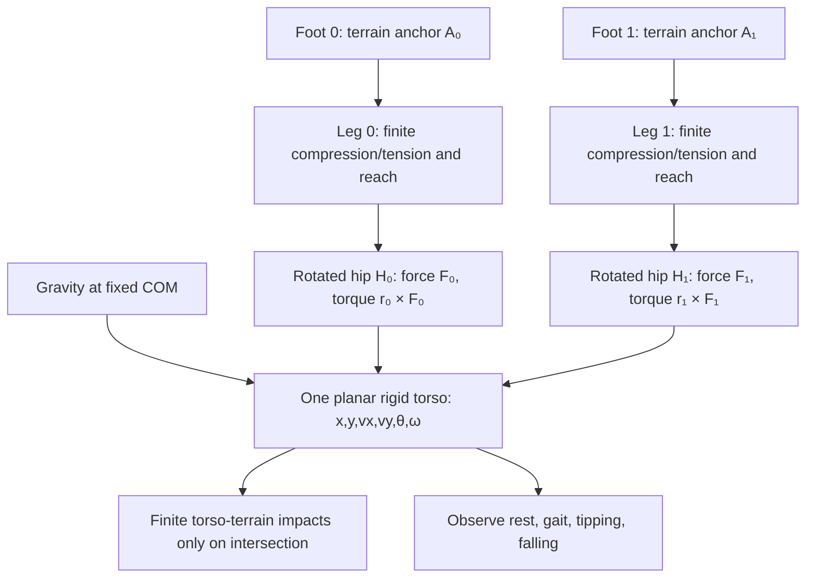

# Sisyphus — two-contact mechanics proposal

**Status:** design only, not implemented. **Witness:** executing `990d251faf8045fcdca97fee9ff9059ae090f7c1`, 2026-10-16, 71.68 FPS at t=6.7417 s. **Canonical experiment:** [Shell](https://bonoj.github.io/Abyss/shell/). **Chronology:** [LOCOMOTION.md](./LOCOMOTION.md), especially BA.

## Design contract

Keep exactly **one planar rigid torso** with position `(x,y)`, linear velocity `(vx,vy)`, pitch `θ`, angular velocity `ω`, mass `m=1` in current normalized units, and fixed moment of inertia `I=0.085`. Gravity acts at the body's fixed center of mass (COM). Two **massless feet** can contact the terrain at independent world-space anchors. Two finite-force leg elements join the feet to **two distinct torso-local hip points**. Do not add knees, leg masses, IK authority, a second integrator, prescribed gait, automatic righting, pitch clamps, or positional leg-height correction. The torso only contacts terrain when its own finite shape hits it.

### Geometry — schematic side view (x/y plane, not to scale)

```text
                 body-fixed frame, rotated by θ
                         ↑ body axis
                    ┌───────────┐
                    │     ● C   │ ← fixed COM: (x,y), mass m, inertia I
                    │           │
                    └─●───────●─┘
                     H₀       H₁   ← distinct body-local attachment points
                      ╲       ╱
                       ╲     ╱     ← compliant finite-force legs, ℓ₀ and ℓ₁
                        ╲   ╱
                         ╲ ╱
     terrain ──────●───────────●─────────────────
                   A₀          A₁ ← independently planted feet
                        ↑
                 support interval in x
```

The drawing is conceptual: hip points rotate rigidly with the body and need not remain horizontally arranged in world coordinates. Feet need not be symmetrically placed at all times. For a **planar** walker, separate feet along the x direction, not solely along z: lateral z separation alone supplies no useful x/pitch support polygon in this model. The two hips should have a modest **body-local x separation** while retaining their existing below-COM y offset; choose dimensions explicitly from the existing torso radius/shape before implementation, rather than silently tuning them.



## Mechanics

For each foot `i∈{0,1}`, let `aᵢ` be its planted world-space anchor and `hᵢ` its constant torso-local attachment offset. Let `R(θ)` rotate a body-local vector into the world frame, `rᵢ=R(θ)hᵢ`, and `Hᵢ=C+rᵢ`. In the existing x/y convention, rotation is chosen to match the current solver's signed pitch and mesh orientation; verify signs against its actual transform rather than adopting an independent convention.

- Leg vector `dᵢ=Hᵢ−aᵢ`; length `ℓᵢ=|dᵢ|`; outward unit direction `nᵢ=dᵢ/ℓᵢ`.
- Hip point velocity `vHᵢ=vC+ω×rᵢ`; radial length rate `ℓ̇ᵢ=nᵢ·vHᵢ` while the foot is planted.
- Finite axial compression (push) and tension (pull) follow the **existing** stiffness, damping and force caps. Compression pushes from anchor toward hip (`+nᵢ`); tension pulls hip toward anchor (`−nᵢ`). Avoid a force jump or hidden impulse when the connection crosses its reach boundary.
- Let `Fᵢ` be the **actual total force transmitted by leg i**. Net COM force is `F₀+F₁+m g+F_body_contact`; net pitch torque is `τ=(r₀×F₀)_z+(r₁×F₁)_z+τ_body_contact`, with the sign adjusted to the solver's pitch axis. **Every force is counted once in translation and once through its physical moment arm in rotation.** Never calculate torque from one force while adding a different force to COM translation.
- With no body collision: `m aC=m g+ΣFᵢ`; `I α=Στᵢ`. The current 120 Hz kinetic integrator alone advances state. Body impacts add contact impulses and angular impulse via the same rigid-body state.

**Ground contact and traction are separate.** A foot may be anchored yet unloaded; anchored does not imply a positive reaction force. A foot that swings or loses actual contact cannot transmit stance traction. Contact friction caps tangential traction by the physically supported normal reaction (Coulomb bound `|F_t|≤μN`); do not synthesize `N=mg` for each planted foot independently and thereby double available grip. If a leg force model remains purely axial, it may still be unable to hold an upright body at all poses. That is an observation, not an excuse to fake stability.

**Reach must be physically finite.** The present code uses `maxLength=1.04` for a `connected` flag but continues to compute tensile force when `ℓ>maxLength`. That is a semantic contradiction. Choose and document one physically honest mechanism: a finite maximum-extension tether that remains mechanically connected while taut, or a breakable/releasable leg that transmits **zero** force once detached. Do not report disconnected while still transmitting tension. Avoid instantaneous teleportation or infinite-force projection. Replant only where terrain exists and the foot can actually reach.

**Load sharing:** both legs can carry force simultaneously. There is no automatic 50/50 split: force depends on each leg's length, length rate, attachment geometry and contact. The existing `loadShares=[1/count]` is an anchor count, not a measurement of mechanical load. Distinguish anchor, contact, connectivity, axial force, and normal reaction in inspection.

## Why two feet help — and what they do not guarantee

Two x-separated terrain contacts create a base over which the COM's ground projection can lie. Distinct body-local hip points give two independent force lines and thus potentially different torques about the COM. This increases the **possibility** of balancing; it does **not** guarantee it. If the feet share a point or both legs transmit nearly identical collinear forces, the extra contact provides little pitch authority. If the COM projection leaves the support region or available forces cannot balance gravity/torque, Sisyphus should tip. No orientation controller is proposed for the first experiment. Observe passive geometry before adding sensing.

## Current implementation versus proposed model

| Current, witnessed or source-inspected | Proposed |
|---|---|
| One rigid body, fixed COM, fixed I, 120 Hz | Preserve |
| Two foot anchors initialized at the same `(x,z)` | Two initially distinct x anchors, sampled against real terrain |
| Only one active strut force applied at a time | Sum two independently evaluated stance forces |
| Both forces would share a single hip offset `(0,-.24)` | Separate torso-local hip points with consistent rotation |
| `forceX=-4` stance drive in world −x | Retain as an explicit motor term only if correctly applied at its hip and limited by actual contact; do not treat it as passive strut force |
| `loadShares` from planted-foot count | Actual per-leg transmitted forces and support states |
| `connected=false` can coexist with nonzero tension | Unambiguous finite-reach connection model |
| Two endpoint-sphere body probes; `impacts:0` despite first endpoint impact | Keep finite collision approximation initially, correct impact counters |
| Rendered capsule follows pitch | Preserve and visually verify |

## Latest witness and interpretation

Build `990d251f`, t=6.7417, 71.68 FPS: 14/14 grounded handoffs, zero unsupported handoffs, 785 connected and 24 disconnected strut steps, 178 tensile steps, 112 geometric overextension observations, body pitch 4.71199 rad (~270°), omega −0.05089 rad/s, hip (−0.17611,1.27664), active anchor (−0.97053,1.15005), length .80445, force magnitude 6.339. The body has nearly settled in an inverted/sideways orientation; it has not demonstrated upright equilibrium. Max body endpoint pre-correction penetration .029777. `noFootSupportSteps=0` measures no anchors; kinetic `terrainSteps=24` measures no connected active strut. These are not contradictory if labeled honestly.

## Three small implementation turns

1. **Independent geometry and consistent wrench.** Preserve COM/inertia, gravity, gait constants and solver. Add two distinct body-local hip offsets, two distinct terrain-sampled initial x anchors, and sum forces and torques from both **planted and connected** legs. Check sign conventions and that actuator traction is neither double-counted nor detached from its hip. Commit; collect executing SHA and inspector.
2. **Truthful finite reach/contact accounting.** Resolve the current connected/tension contradiction; distinguish anchors, true foot contact, force-bearing legs and disconnected steps; instrument per-leg `Hᵢ,aᵢ,ℓᵢ,ℓ̇ᵢ,Fᵢ,τᵢ`, net wrench, and body endpoint impacts. No arbitrary pitch limits or resets. Commit; collect witness.
3. **Observe before controlling.** Watch a standing start, double support, single support, first fall/body collision, and eventual rest. Record visual agreement, pitch/omega, foot forces, penetration, and FPS. Only correct witnessed mechanical inconsistencies. **No posture feedback yet**, no knees, no full skeleton, no new performance work above 55 FPS.

**Acceptance:** an intelligible fall is a valid result. Stable standing should emerge only if forces and geometry actually balance. The proposal is deliberately small and falsifiable.
